<div align="center">

# 中山大学实验报告

</div>

| 项目 | 内容 |
| :--- | :--- |
| 学院 | 计算机学院 |
| 课程名称 | 数据结构与算法（人机协作） |
| 题目 | 线性表（链表）与可变数组：Baseline 1–3 实验报告 |
| 学号 |24325187 |
| 姓名 |刘雅静 |
| 专业名称 | 计算机科学与技术（人工智能与大数据方向） |
| 任课教师 | 郑馥丹 |
| 实验地点 | 实验中心E402 |
| 实验日期 | 2026年10月13日 --- 10月17日 |


---

## 目录

- [一、项目分析与设计](#一项目分析与设计)
- [二、人机协作过程](#二人机协作过程)
  - [(1) Prompt 设计与思路](#1-prompt-设计与思路)
  - [(2) 审查、测试与优化过程](#2-审查测试与优化过程)
- [三、最终产物](#三最终产物)
- [四、项目总结](#四项目总结)

---

## 一、项目分析与设计

本次实验完成《线性表》章节的三个 Baseline 任务，全部位于 `src/Linear/Baseline/List/` 下，按 `baseline1` / `baseline2` / `baseline3` 三个互相独立的提交目录组织。下面分别说明每个 Baseline 的任务要求、设计方案与关键取舍。

### baseline1：链表的基本实现

**任务要求**：① 编写链表基本实现（节点定义、初始化、插入、删除、访问、查找等）并写测试程序；② 将链表实现为支持任意类型的模板类；③ 按统一输入输出格式编写命令式测试程序。

**设计方案**（三个小任务分目录）：

| 小任务 | 目录 | 内容 |
| :--- | :--- | :--- |
| 1 | `src/task1_basic_list/` | 教程风格的裸节点 `ListNode` + 四个教程操作 `insert` / `remove` / `access` / `find`，扩展 `build_list` / `push_front` / `push_back` / `length` / `contains` / `reverse` / `to_vector` / `free_memory` |
| 2 | `src/task2_linked_list/` | 模板类 `LinkedList<T>`：RAII 内存管理（析构释放、深拷贝、自赋值安全）、尾指针优化、越界异常 |
| 3 | `src/task3_command_test/` | 复用 `LinkedList<T>` 的命令式测试程序，读取 `inputs/` 与 `outputs/` 逐用例比对 |

**关键取舍**：

- **四个教程操作与教程逐行一致**：`insert` 只改写两条引用（$O(1)$）、`remove` 负责 `delete` 被删节点、`access` 从头遍历（$O(n)$）、`find` 返回首个匹配下标（不存在返回 `-1`），保证与学习材料一致。
- **模板类封装**：裸节点版本由“头节点代称整表”，多处操作需手动维护指针；封装为 `LinkedList<T>` 后将节点所有权交给类，构造/拷贝/析构统一管理。**深拷贝是必需而非可选**——裸指针的浅拷贝会让两个对象共享同一批节点，析构时 double free。
- **尾指针优化**：额外维护 `tail_`，使 `push_back` 从需遍历全表的 $O(n)$ 降为 $O(1)$；并在删除头/尾节点、`reverse`、`clear` 时同步维护 `tail_`。
- **异常语义对齐标准库**：越界的 `at` / `insert` / `erase` 抛 `std::out_of_range`，与 `std::vector::at` 行为一致。

### baseline2：可变数组的实现

**任务要求**：① 实现支持动态扩容与随机访问的可变数组类；② 评估其与 `std::vector` 的差异；③ 参照 `<vector>` 新增 ≥5 个功能；④ 分析可变数组与链表在不同场景下的性能差异。

**设计方案**（四个小任务分目录）：`task1_vector`（核心 `Vector<T>` + 命令式测试）、`task2_performance`（vs `std::vector`）、`task3_extended_vector`（扩展 6 功能）、`task4_array_vs_list`（vs 链表）。

**核心数据结构 `Vector<T>`**：在一段连续堆内存上维护“已用长度 `size_`”与“已分配容量 `capacity_`”两个计数。`size_ < capacity_` 时 `push_back` 只需写入 `data_[size_++]`，不重新分配；仅当 `size_ == capacity_` 时按 **2 倍**策略扩容。

**为何 2 倍扩容能达到均摊 $O(1)$**：从容量 1 扩到 n 的总搬移量为 $1 + 2 + 4 + \dots + n/2 < n$ 的等比级数，即 $\Theta(n)$，平摊到 n 次追加为常数。这一策略也与课程 README 官方样例中“`CAPACITY` 输出假设容量翻倍”的注记一致（样例容量 `4 → 8`）。

**为何随机访问是 $O(1)$**：元素连续存放，`data_[i]` 是一次指针算术。这正是“既能随机访问、又能动态扩容”的实现基础——随机访问来自连续内存，动态扩容来自容量与长度解耦。

**扩展的 6 个功能**（对照 `<vector>`）：`pop_back` / `resize` / `swap` / `assign` / `find` / `shrink_to_fit`，其中 `swap` 只交换指针与计数（$O(1)$），`find` 是 `std::vector` 没有而常见容器接口（如 Java `ArrayList.indexOf`）具备的查找能力。

### baseline3：链表进阶算法（幽灵交叉路口）

**任务要求**：融合“反转链表 / 环形链表 / 相交链表”三个经典场景的综合题，依次完成**探查环路并解除**、**寻找交汇点**、**将公共部分局部反转**三个挑战；要求封装为清晰的函数模块，测试需**手动构造**成环单链表、不相交两链表、相交两链表并做命令行可视化；**总时间复杂度 $O(n)$、空间复杂度 $O(1)$，禁用哈希表或额外数组记录节点**。

**设计方案**：`GhostIntersection` 纯静态求解类 + `Scenario` RAII 场景持有者。

| 算法 | 语义 | 时间 | 空间 |
| :--- | :--- | :--- | :--- |
| `detectAndRemoveCycle` | Floyd 快慢指针探环 → 定位环入口 → 就地解环，返回入口结点 | $O(n)$ | $O(1)$ |
| `getIntersectionNode` | 双指针找两链表交汇点（比较**指针**而非值） | $O(\text{lenA}+\text{lenB})$ | $O(1)$ |
| `reverseSharedPath` | 仅反转公共尾部，各自独立前缀不被破坏 | $O(n)$ | $O(1)$ |

**关键取舍**：

- **不用哈希表**：用哈希表记录访问过的节点能在首次重复时找到环入口，但需 $O(n)$ 额外空间，违反题目的 $O(1)$ 空间约束；Floyd 快慢指针 + “入口定位”两步法无需任何额外容器。
- **全迭代不递归**：递归解法会引入 $O(n)$ 的调用栈空间，同样违反 $O(1)$ 约束。
- **求交汇点比较指针而非值**：两条链表可能含有相同值却不共享节点（已专门设用例验证），按值比较会误判。
- **`reverseSharedPath` 的两个设计要点**：（a）head 必须按引用传入——前缀为空时该链表的头结点本身就是交汇点，反转会改变头；（b）必须在**反转之前**捕获两条前缀的尾结点，否则会闭合成环（详见第二节的缺陷 6）。
- **防泄漏的内存管理规则**：统一由 `Scenario` 析构处理——① 先解环再释放，对仍成环的链表直接释放会沿环无限遍历；② 共享尾部只释放一次，相交链表两个头都释放会双重释放公共尾部（故各自前缀释放到 `boundary` 为止，公共部分只释放一次）。

### 三个 Baseline 的复用与层次关系

三个 Baseline 之间保持“底层实现 → 高层封装 → 应用”的递进，并通过复用避免重复造轮子：

- baseline1 的 `LinkedList<T>` 与 `basic_list`（裸节点）是整章的基础；
- baseline2 的链表对比程序（`task4`）复用 baseline1 的 `LinkedList<T>`（以副本形式内联，保持提交自包含）；
- baseline3 的节点层复用 baseline1 的 `basic_list`（以副本形式内联）。

## 二、人机协作过程

### (1) Prompt 设计与思路

本次实验全程与 AI 协作完成。核心 Prompt 策略是**分阶段下达、逐阶段验收**，并把“看起来对”转化为“可验证的对”。以下按实际下达顺序给出各阶段的代表性提示词（配截图）。

**阶段一：确立风格与结构约束。** 首轮即限定“使用和学习材料一样的代码结构、代码语言、代码风格，同时给代码加上适当的中文注释，并将三个小任务的代码分开”，并明确指向 `src/Linear/Baseline/List/README.md` 中的学习材料与任务内容。这样 AI 产出的不是通用模板代码，而是贴合课程教程（`ListNode`、`dsaac` 命名空间、中文注释）的实现。

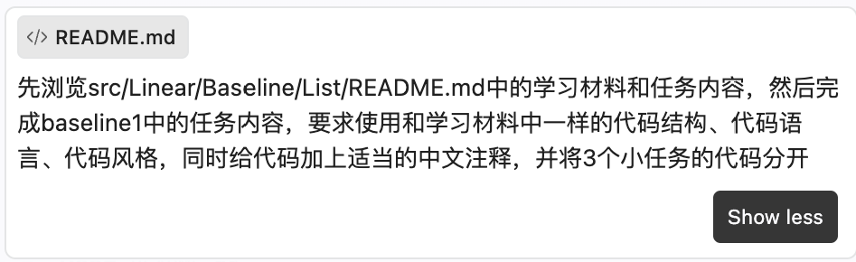

*图 1　明确 baseline1 任务的风格与结构约束*

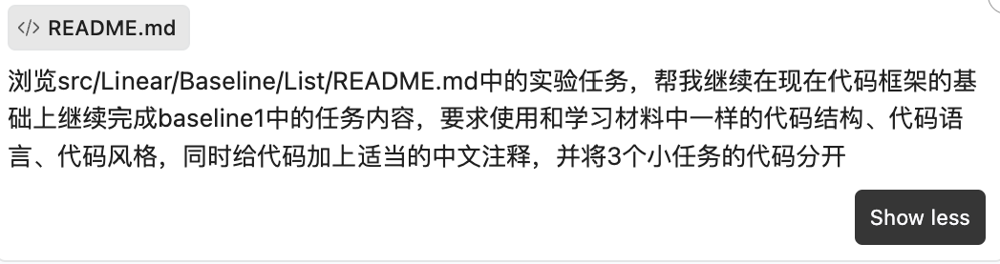

*图 2　在现有代码框架的基础上继续完成 baseline1*

**阶段二：按提交规范组织目录与文档。** 要求目录满足课程 README 的提交表格——`inputs/` 放样例、`outputs/` 放同名标准输出、测试程序命名为 `test`、提供 `Makefile`（一条命令编译 + 样例测试目标）。随着 baseline 增多，进一步要求把说明文档合并、按 baseline 重新组织，使每个提交目录自包含、命名规范统一。

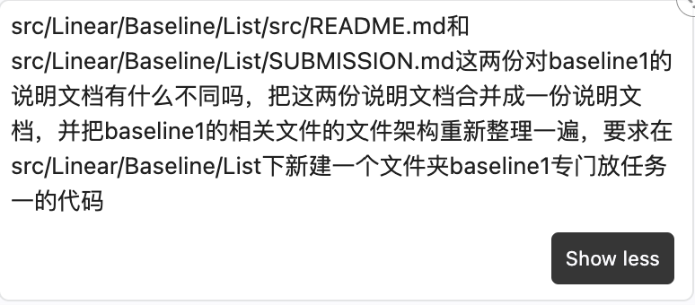

*图 3　合并 baseline1 的两份说明文档并重整目录结构*

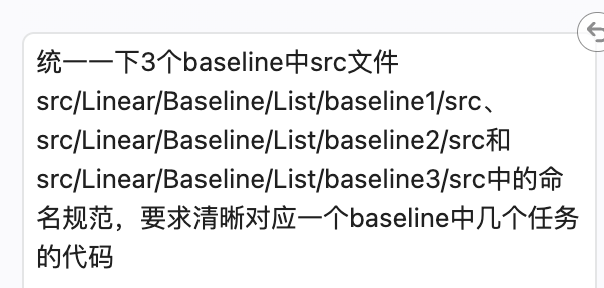

*图 4　统一三个 baseline 的 src 命名规范*

**阶段三：逐个 Baseline 推进，每个完成后回归核对。** baseline2、baseline3 的需求均沿用“和 baseline1 一样”的结构与风格约定；每完成一个 Baseline 即追加一句“根据 README 的任务内容、提交材料要求、输入输出样例要求再次核对是否符合提交要求”，形成“实现 → 核对 → 修复 → 再核对”的闭环。这一步多次暴露了仅凭“编译通过”看不出的问题（详见下一小节）。

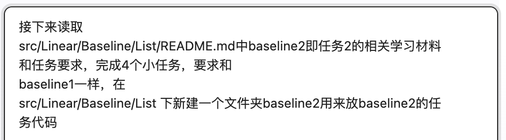

*图 5　启动 baseline2*

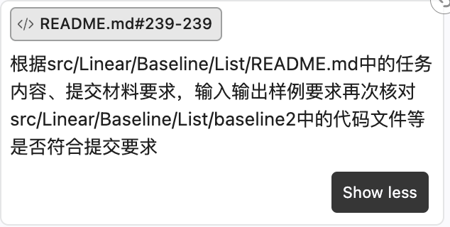

*图 6　要求核对 baseline2 是否符合提交要求*


*图 7　启动 baseline3*

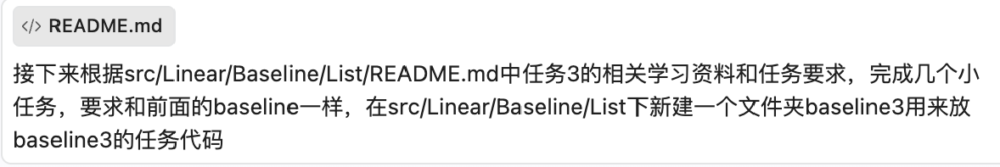

*图 8　要求核对 baseline3 是否符合提交要求*

**阶段四：对关键设计决策要求 AI 给出推荐并说明取舍。** 对于“环形链表与相交链表的防泄漏释放如何组织代码”这类有多个合理方案的问题，要求 AI 用“选项 + 推荐 + 理由”的形式回答（最终选择了「求解类 + RAII 场景持有者」），而不是让 AI 直接替我决定。

**贯穿全程的一条原则**：要求 AI **复用既有实现**（如 baseline2 的链表对比复用 baseline1 的链表、baseline3 复用 baseline1 的节点层），而非另起炉灶重写。

### (2) 审查、测试与优化过程

**本节是本报告的核心**。AI 能快速产出结构完整的代码，但“产出”不等于“正确”——本次协作中共发现并修复 **9 处缺陷**，它们分属编译期、运行期、内存、设计四个层面，若非逐层验证不会暴露：

| # | 缺陷 | 发现方式 | 修复 |
| :--- | :--- | :--- | :--- |
| 1 | baseline1 的 `Makefile` 中可执行文件 `test` 与伪目标 `test` 同名，make 报循环依赖、**二进制从未被生成** | 实际执行 `make` 报错 | 运行目标改名为 `check`，加注释说明成因 |
| 2 | `test_command.cpp` 的 `#include "linked_list.hpp"` 编译失败（头文件在上一级目录） | `make` 编译错误 | 改为相对路径 `../task2_linked_list/linked_list.hpp` |
| 3 | 自测样例 `case02` 声明 `m=9` 实为 13 个操作；`case03` 期望输出漏写一行 `ERROR` | `make check` 出现 FAIL 后逐条核对语义 | 校正 `m` 值与期望输出 |
| 4 | baseline2 的 `task2`/`task4` include 路径错误；且 `std::vector` 的 `insert`/`erase` 是**迭代器式**接口，模板基准直接下标调用编译失败 | 编译错误 | 增加 `insertAt`/`eraseAt` 重载，统一自实现（下标式）与 `std::vector`（迭代器式）的接口差异 |
| 5 | baseline2 的性能汇总比值**二次运行**基准，引入计时噪声，导致比值与明细数值漂移、互相矛盾 | 对比两轮输出发现数值不一致 | 改为复用首次测量结果计算比值 |
| 6 | **baseline3 `reverseSharedPath` 若“先反转再沿前缀找尾结点”会闭合成环** → `to_vector` / `free_memory` 永久挂死 | **设计阶段**由对抗性审查 + 手工推演官方样例复现（`9->next = 9` 自环） | 改为**反转前**先捕获两个前缀尾结点；head 按引用传入以支持空前缀 |
| 7 | 双指针求交汇点的常见写法 `pA = pA->next; if (!pA) pA = headB;` 在**不相交时死循环** | 设计阶段推演 | 改为 `pA = pA ? pA->next : headB;`，使比较能看到 `nullptr` |
| 8 | `manual` 程序对**仍成环**的链表调用 `to_vector` 做可视化会无限打印 | 自查代码路径 | 新增限步 `visualizeCyclic`，解环后才用 `to_vector` |
| 9 | 课程 README（原始任务文档，不可改动）被误改 | `git status` 发现 | `git restore` 恢复为原始版本，说明内容另立 `baseline1/README.md` |

**测试结果**。下图为缺陷修复后，对三个 baseline 依次执行 `make check` 的终端输出——样例比对分别 **3/3、6/6、8/8** 全部通过。注意：缺陷 1（Makefile 目标名冲突）与缺陷 3（样例 `m` 值与期望输出错误）均已修复，因此此处显示的是**修复后的通过状态**，而非最初的报错：

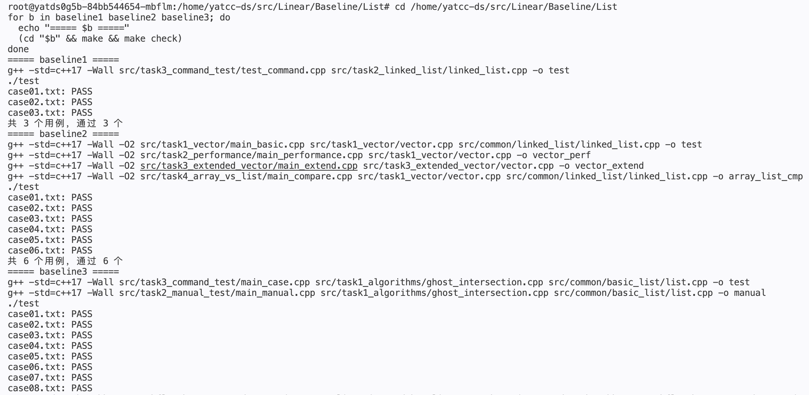

*图 9　三个 baseline 的 `make check` 全部通过*

**缺陷 6 值得展开**——它是最严重的一处，也是最能说明“为什么必须审查”的一处：

共享尾部 `7→8→9`、ListA 前缀尾结点为值为 20 的节点（其 `next` 指向 7）。若先反转共享段，反转会把汇聚点的 `next` 置空并把方向改为 `9→8→7`，但前缀尾结点 `20` 的 `next` **仍然指向节点 7**。此时若再“沿前缀走到尾结点”去重新接线，遍历会越过原前缀尾、直接走进已反转的共享段，最终把 `9->next` 设成 `9`，闭合成自环——之后 `to_vector` 与 `free_memory` 都会永久挂死。**该缺陷在代码尚未写完的设计阶段就被发现**：先让 AI 对方案做对抗性审查，再由我手工按官方样例逐步推演复现。

**测试策略小结**：采用**三重独立验证**，使不同类型缺陷暴露在不同环节：

1. **样例逐字符比对**（`make check`）——暴露逻辑与 I/O 语义错误；
2. **单元断言**（`make unit`）——暴露边界行为错误；
3. **ASan + LSan 内存检查**（`make asan`）——暴露泄漏与双重释放。

其中 baseline2 还引入**交叉校验**：把同一操作序列同时驱动自实现的 `Vector<T>` 与 `std::vector`，功能行逐行比对——任一实现出错都无法通过，比“分别测试”更强的验证。

## 三、最终产物

三个 Baseline 的完整代码、样例与文档均已就绪于 `src/Linear/Baseline/List/`：

```text
List/
├── README.md                       ← 课程原始任务文档（未改动）
├── baseline1/                      ← 链表基本实现（3 小任务）
│   ├── Makefile / README.md
│   ├── inputs/ (case01~03) + outputs/
│   └── src/{task1_basic_list, task2_linked_list, task3_command_test}/
├── baseline2/                      ← 可变数组（4 小任务）
│   ├── Makefile / README.md
│   ├── inputs/ (case01~06) + outputs/
│   └── src/{common/linked_list, task1_vector, task2_performance,
│            task3_extended_vector, task4_array_vs_list}/
└── baseline3/                      ← 幽灵交叉路口（3 算法 + 2 测试程序）
    ├── Makefile / README.md
    ├── inputs/ (case01~08) + outputs/
    └── src/{common/basic_list, task1_algorithms, task2_manual_test,
             task3_command_test}/
```

每个子目录均带 `README.md`；每个 Baseline 均提供 `test` 程序、`Makefile`（`make` 一条命令编译、`make check` 运行样例比对），并附实现分析文档。

**验证结果汇总**（重跑确认，与各 `README.md` 的「验证记录」一致）：

| Baseline | 编译 | 样例比对（`make check`） | 单元断言（`make unit`） | ASan / LSan |
| :--- | :--- | :--- | :--- | :--- |
| baseline1 | 无警告 | 3 / 3 PASS | 46 项全通过 | 干净退出 |
| baseline2 | 无警告 | 6 / 6 PASS | 16 项全通过 | 干净退出 |
| baseline3 | 无警告 | 8 / 8 PASS | 6 项全通过 | exit = 0 |

其中 baseline1 的 case01、baseline2 的 case01、baseline3 的 case01 均与课程 README 的**官方样例逐行一致**，作为正确性锚点。

**性能实测数据**（g++ 15.2、`-O2`、Linux x86-64；每项重复 5 次取平均）：

*（一）可变数组 vs `std::vector`*（比值 = 自实现耗时 / `std::vector` 耗时，>1 表示自实现更慢）：

| 场景 | n | 可变数组 time_ms | std::vector time_ms | 比值 |
| :--- | :--- | :--- | :--- | :--- |
| append（尾部追加） | 1000000 | 4.72 | 2.78 | 1.70 |
| append_reserve（预留后追加） | 1000000 | 2.59 | 0.81 | 3.22 |
| access（随机访问） | 1000000 | 7.24 | 2.79 | 2.60 |
| insert_front（头部插入） | 10000 | 2.10 | 2.02 | 1.04 |
| erase_front（头部删除） | 10000 | 2.12 | 2.06 | 1.03 |

*（二）可变数组 vs 链表*（比值 = 链表耗时 / 可变数组耗时，>1 表示链表更慢）：

| 场景 | n | 可变数组 time_ms | 链表 time_ms | 比值 |
| :--- | :--- | :--- | :--- | :--- |
| append（尾部追加） | 1000000 | 4.56 | 36.91 | 8.10 |
| prepend（头部插入） | 10000 | 2.08 | 0.29 | 0.14 |
| traverse（顺序遍历） | 1000000 | 4.07 | 35.56 | 8.74 |
| random（随机访问 2000 次） | 1000000 | 3.15 | 2344.68 | **743.8** |

**结果解读**：

- 自实现 `Vector<T>` 与 `std::vector` 在**算法复杂度上完全一致**（均摊 $O(1)$ 追加、$O(1)$ 随机访问、$O(n)$ 中间插删），差距集中在**实现质量的常数因子**：`std::vector` 通过 allocator 申请未初始化内存、仅对实际元素用 placement new 构造，而本实现用 `new T[]`（需默认初始化）——这在 `append_reserve` 场景放大为 3 倍以上；头部插删被 $O(n)$ 搬移主导，两者几乎持平（1.03~1.04），反证差距来自常数而非算法。
- 可变数组与链表的差距由**内存布局与访问复杂度**决定：随机访问 $O(1)$ vs $O(n)$，差值高达 **743.8 倍**；尾部追加与顺序遍历因链表逐节点分配、缓存不友好而慢 8 倍左右；只有头部插入这一链表的结构性优势场景，链表反超（比值 0.14，即链表快约 7 倍）。

**程序运行输出（实测节选）**。以下为各 Baseline 的实际运行输出，佐证上表的验证结果：

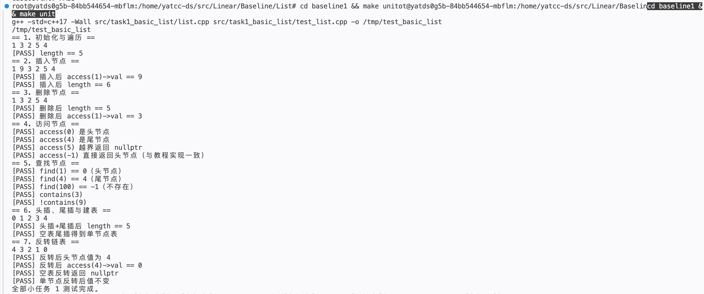

*图 10　baseline1 小任务 1 的单元断言：教程四操作的位置语义、空表/单节点/越界等边界、反转后的头尾指针*

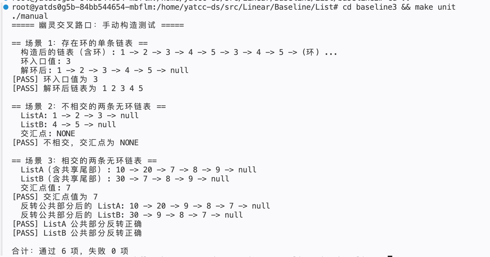

*图 11　baseline1 小任务 2 的单元断言：int/double/char 三类型实例化、深拷贝隔离、越界抛异常、尾指针一致性*

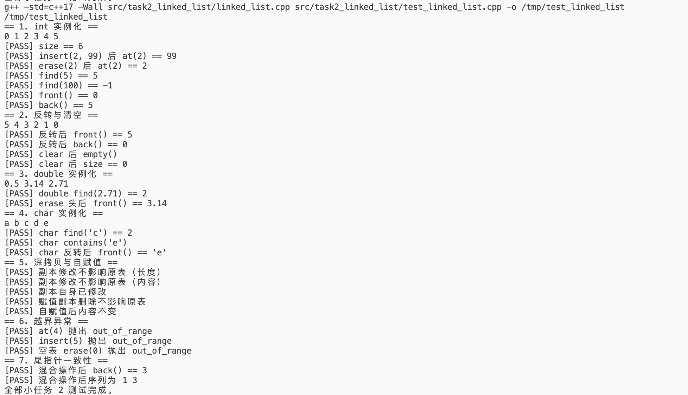

*图 12　baseline2 扩展功能 16 项自测全部通过，并输出扩展数组与 `std::vector` 的耗时对比*

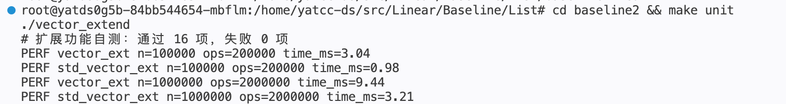

*图 13　baseline3 手动构造测试的逐步可视化输出：环入口值、不相交判定、交汇点与公共部分反转结果*

## 四、项目总结

**数据结构层面**：本次实验把链表与可变数组从“会用”推进到“能实现、能分析”。几个具体收获：① 均摊复杂度的意义——2 倍扩容单次是 $O(n)$，但等比级数求和后整体是 $\Theta(n)$，故均摊 $O(1)$；② 缓存局部性对常数因子的决定性影响——数组与链表算法复杂度相同，实测却差 8 倍，根源是连续内存 vs 逐节点分配；③ RAII 与所有权——把裸节点的内存管理封装进类，用类型系统而非调用方纪律来保证不泄漏；④ 空间约束如何影响算法选择——$O(1)$ 空间要求直接排除了哈希表解法，逼出 Floyd 双指针这类更精巧、也更值得理解的算法。

**人机协作层面**：最深的体会是 **AI 的产出必须被验证，且验证要分层**。本次 9 处缺陷中，编译期缺陷靠 `make` 暴露、运行期缺陷靠样例比对暴露、内存缺陷靠 ASan 暴露——而**最严重的自环死循环缺陷（缺陷 6）根本没跑起来**：它是在设计阶段，通过让 AI 对方案做一轮对抗性审查、再由我手工按官方样例逐步推演才发现的。这说明协作的有效模式不是“AI 写完我验收”，而是“每一步都要求可验证的证据，并在动手前对关键算法做推演”。

**方法论沉淀**：① 先核对提交规范再动手，避免返工；② 对有多个合理方案的设计点，用“选项 + 推荐 + 理由”请 AI 说明取舍，而非让它替我拍板；③ 要求 AI 复用既有实现，避免重复造轮子；④ 每个模块完成后回归核对，把“看起来对”变成“验证过对”。

**不足与改进**：性能基准只做了 5 次平均，未做统计显著性检验；`Vector<T>` 缺少 move 语义与迭代器接口，使其与标准库仍有常数级差距（虽不影响算法复杂度）。这些都是后续可以继续优化的方向。