<div align="center">

# 中山大学实验报告

</div>

| 项目 | 内容 |
| :--- | :--- |
| 学院 | 计算机学院 |
| 课程名称 | 数据结构与算法（人机协作） |
| 题目 | 栈与队列：Baseline 1–3 实验报告 |
| 学号 | 24325187 |
| 姓名 | 刘雅静 |
| 专业名称 | 计算机科学与技术（人工智能与大数据方向） |
| 任课教师 | 郑馥丹 |
| 实验地点 | 实验中心E402 |
| 实验日期 | 2026年10月14日 --- 10月18日 |


---

## 目录

- [一、项目分析与设计](#一项目分析与设计)
- [二、人机协作过程](#二人机协作过程)
  - [(1) Prompt 设计与思路](#1-prompt-设计与思路)
  - [(2) 审查、测试与优化过程](#2-审查测试与优化过程)
- [三、最终产物](#三最终产物)
- [四、项目总结](#四项目总结)

---

## 一、项目分析与设计

本次实验完成《栈和队列》章节的三个 Baseline 任务，全部位于 `src/Linear/Baseline/StackAndQueue/` 下，按 `baseline1` / `baseline2` / `baseline3` 三个互相独立的提交目录组织。三层都复用课程给定的骨架（`../src/array_stack`、`../src/linked_stack`、`../src/queue`），以相对路径引用而非复制副本，避免与骨架漂移。下面分别说明每个 Baseline 的任务要求、设计方案与关键取舍。

### baseline1：栈的基本实现

**任务要求**：① 分别用**数组**和**链表**实现栈类，要求通过给定的测试程序（本部分不可修改测试程序）；② 用完整测试程序评估两种实现的性能差异并分析；③ 参考 C++ `<stack>` 库，在已有栈类上再实现 5 个功能，并与 `<stack>` 对比性能。

**设计方案**（两个提交程序）：

| 小任务 | 文件 | 可执行程序 | 内容 |
| :--- | :--- | :--- | :--- |
| 1 / 2 | `src/main_test.cpp` | `test` | 数组栈与链表栈**交叉校验** + 数组 / 链表 / `std::stack` 三方性能对比 |
| 3 | `src/extended_stack.*`、`src/main_extend.cpp` | `stack_extend` | 扩展 5 功能 + 自测 + 与 `std::stack` 对比 |

**关键取舍**：

- **数组栈的固定容量语义**：构造时 `reserve(capacity)` 一次性预留，`push` 前先判 `full()`，保证元素数永不超容量、`vector` 永不扩容。`full()` 直接用 `values_.capacity()` 作容量上界而不另存一个 `capacity_` 成员——这一点**成立的前提正是"先判满再 push"**，故 `capacity()` 恒等于构造时的 `reserve` 值。链表栈按需分配、无容量上限，故接口不含 `full()`。
- **交叉校验驱动**：`test` 把同一初始元素与操作序列在**两种实现上重放并逐行比对**，任一实现出错都会在 stderr 报错。同一份样例同时验证两种实现，比"分别测试"更强。为使两实现输出可比，驱动层统一以输入的 `capacity` 为上界对两栈限流（链式栈的"无界"仅体现在类本身）。
- **受限接口下的 SIZE / PRINT**：两栈接口均无 `size()`、无遍历。驱动用**倒栈技巧**——逐个弹出到 `vector`（天然得到栈顶→栈底序），计数/打印后逆序压回恢复原状，$O(n)$。
- **扩展功能以独立模板类实现**：因给定 `stackar.hpp` / `stackli.hpp` **不可修改**，5 个扩展功能无法加进基础类，故另立 `dsaac::ExtendedArrayStack<T>` / `ExtendedLinkedStack<T>`（自带存储，接口风格与骨架一致）。

**扩展的 5 个功能**（对照 `<stack>`，注意 `std::stack` 本身**不含**这些接口）：

| 功能 | 语义 | 复杂度（数组 / 链表） |
| :--- | :--- | :--- |
| `clear()` | 删除全部元素 | $O(n)$ / $O(n)$ |
| `swap(other)` | 交换两栈内容 | $O(1)$ / $O(1)$ |
| `search(v)` | 元素距栈顶 1 基位置，未找到 `-1` | $O(n)$ / $O(n)$ |
| `peek(depth)` | 访问距栈顶第 `depth` 个元素，越界抛 `std::out_of_range` | $O(depth)$ / $O(depth)$ |
| `reverse()` | 原地反转整栈 | $O(n)$ / $O(n)$ |

**对齐 `<stack>` 的接口语义**：除上述成员外，另提供**非成员** `swap(a, b)` 与六个比较运算符 `== != < <= > >=`（按"栈底→栈顶"字典序，与 `std::stack` 一致），使扩展栈在**调用形式**上与标准库对齐。同时统一两实现的**复杂度契约**：`search` 为 $O(n)$、`peek(depth)` 为 $O(depth)$——数组实现实际为 $O(1)$，即优于契约承诺的上界，二者对外承诺一致。扩展队列（baseline2）同样补齐了非成员 `swap` 与比较运算符。

### baseline2：队列的基本实现

**任务要求**：① 分别用**数组（循环队列）**和**链表**实现队列类并通过给定测试程序；② 针对"`front`/`rear` 到达数组尾部无法继续移动"**设计至少两种**解决方案并实现测试；③ 评估两种实现性能差异；④ 参考 `<queue>` 扩展 5 功能并对比性能。

**设计方案**（三个提交程序）：

| 小任务 | 文件 | 内容 |
| :--- | :--- | :--- |
| 1 / 3 | `src/main_test.cpp` | 循环队列 + 链式队列交叉校验 + 三方性能对比（编译为 `test`） |
| 2 | `src/sized_queue.*`、`src/main_methods.cpp` | 两种"回绕"方案对照（编译为 `queue_methods`） |
| 4 | `src/extended_queue.*`、`src/main_extend.cpp` | 扩展 5 功能 + 与 `std::queue` 对比（编译为 `queue_extend`） |

**两种回绕方案**（都让下标回绕成环，区别在**如何区分空 / 满**）：

| 方案 | 做法 | 判空 / 判满 | 特点 |
| :--- | :--- | :--- | :--- |
| A：空槽法（给定骨架 `CircularQueue`） | 分配 `capacity + 1` 个槽，**故意闲置一格** | `front == back` / `(back + 1) % size == front` | 判据只依赖两个下标，代价是多占 1 槽 |
| B：size 计数法（本目录 `SizedQueue`） | 分配恰好 `capacity` 个槽，令 `rear = (front + size) % capacity` | `size == 0` / `size == capacity` | 存储无浪费、容量 100% 利用，代价是多维护一个计数 |

**关键取舍**：

- **链式队列的 RAII**：`LinkedQueue` 用裸指针维护队首 / 队尾，析构逐个 `delete` 防泄漏，并 `= delete` 拷贝构造 / 赋值（裸指针浅拷贝会 double free）。
- **受限接口下的 SIZE / PRINT**：队列接口无 `size()`、无遍历，驱动用**倒队技巧**——逐个出队到 `vector`（天然得到队首→队尾序），计数 / 打印后按同序压回（FIFO 序不变）。
- **扩展队列以独立模板类实现**：同样因给定 `queue.hpp` 不可修改，扩展 5 功能（`size` / `clear` / `swap` / `back` / `search`）由独立的 `dsaac::ExtendedQueue<T>` 实现。

### baseline3：栈和队列的综合应用

**任务要求**：① **用队列实现栈**并测试；② **用栈实现队列**并测试；③ 用 `<vector>` 实现这两个类，各带一个**互转函数**（栈类→队列类、队列类→栈类）并测试；④ 对比"队列实现栈"与"`<vector>` 实现栈"的差异；⑤ 对比"栈实现队列"与"`<vector>` 实现队列"的差异。

**设计方案**：三个实现模块 + 一个 `T` 场景驱动（编译为 `test`）。

| 模块 | 结构 | 核心思路 | 关键操作复杂度 |
| :--- | :--- | :--- | :--- |
| `StackByQueue` | 单队列 | 入栈入队尾 $O(1)$；栈顶即队尾 `back()` $O(1)$；出栈时把队首元素**旋转** $n-1$ 次使栈顶到队首再出队 | pop $O(n)$ |
| `QueueByStack` | 双栈 | `in_` 负责入队、`out_` 负责出队；`out_` 空时把 `in_` 整体倒入（顺序连续反转两次） | 均摊 $O(1)$ |
| `VectorStack` / `VectorQueue` | `<vector>` | 尾部为栈顶；队列用队首下标 `head_`（出队即 `head_++`，避免头部删除的 $O(n)$） | 均摊 $O(1)$ |

**关键取舍**：

- **队列实现栈用单队列旋转而非双队列**：两者都有一处 $O(n)$，但单队列只需一个队列、状态最少，实现最短。
- **栈实现队列用双栈法**：每个元素至多被搬运一次，**均摊 $O(1)$**，几乎不逊于直接实现——这正是库设计者常用双栈 / 双队列做适配的原因。
- **互转语义明确**：`VectorStack::to_queue()` 按出栈顺序入队（栈顶→队首）；`VectorQueue::to_stack()` 按出队顺序入栈（队首→栈底）。两者置于同一头文件，避免互转函数的循环依赖。
- **`VectorQueue` 用 `head_` 下标而非头部删除**：`vector` 头部删除是 $O(n)$，用 `head_` 前进把出队降为 $O(1)$。

### 三个 Baseline 的复用与层次关系

- 三层**共同复用课程给定骨架** `../src/`（`array_stack`、`linked_stack`、`queue`），以相对路径引用；
- baseline1 的 `ExtendedArrayStack` / `ExtendedLinkedStack` 与给定骨架"接口风格一致但独立存储"；
- baseline3 的 `VectorStack` / `VectorQueue` 自持 `<vector>` 存储，与 baseline1/2 的骨架实现**互不依赖**；
- 三个目录各自自包含（`Makefile` + `README.md` + `inputs/` + `outputs/` + `src/`），单独提交、单独编译。

## 二、人机协作过程

### (1) Prompt 设计与思路

本次实验全程与 AI 协作完成。核心 Prompt 策略是**先摸清给定依赖与文件架构 → 确立风格约束 → 逐个 Baseline 推进 → 逐阶段回归核对**，并把"看起来对"转化为"可验证的对"。以下按实际下达顺序给出五个关键提示词（附截图）。

**阶段一：先弄清楚给定的依赖代码与文件架构。** 动手写代码前，先让 AI 确认 `src/` 目录下原本放置的是什么代码、README 中"所有依赖代码位于 `StackAndQueue\src` 目录下"这句话该如何使用，并请它给出文件架构建议。这一步避免了"不了解骨架就先写、再返工"——最终确定的组织方式正是**复用 `src/` 中给定的骨架实现、各 baseline 目录只放测试程序与骨架之外的实现（如新增的链式队列、扩展类），并以相对路径引用骨架**。

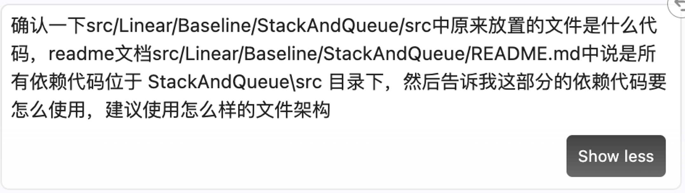

*图 1　确认 `src/` 下的依赖代码用途，并请 AI 建议文件架构*

**阶段二：确立风格约束，完成 baseline1；再把实现归位到给定骨架。** 首轮即限定"使用和学习材料一样的代码结构、代码语言、代码风格，同时给代码加上适当的中文注释，并将 3 个小任务的代码分开"，并指向 `README.md` 中的学习材料与任务内容。这样产出的不是通用模板，而是贴合课程教程（`dsaac` 命名空间、给定骨架接口、中文注释）的实现。

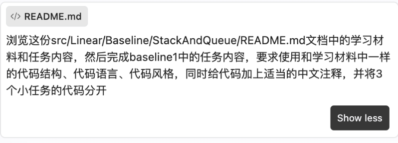

*图 2　完成 baseline1：风格对齐学习材料、加中文注释、三个小任务分开*

写完后进一步要求把 baseline1 的实现**迁移合并到题目给定的 `src/array_stack`**，并强调**不能修改给定的头文件**——要依据给定的 `stackar.hpp` 去改写其余代码。这条约束直接决定了后续所有实现的组织方式：既然是"依据骨架实现、且骨架不可改"，那么扩展功能就只能另立独立类，而不能塞进基础类（详见第一节 baseline1 的扩展设计）。

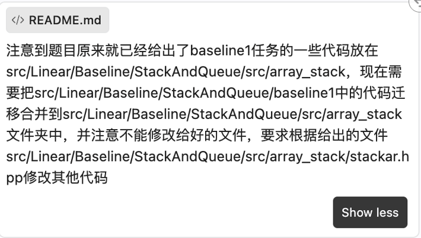

*图 3　把 baseline1 的实现迁移合并到给定的 `src/array_stack`，且不修改给定头文件*

**阶段三：逐个 Baseline 推进，每完成即回归核对。** baseline2、baseline3 的需求均沿用"和 baseline1 一样"的结构与风格约定。全部完成后，让 AI 站在**审查者**角度自检——"`src` 中的代码是否完成了 3 个 baseline 的任务要求、是否达到提交标准、输入输出是否符合样例、代码是否有 bug"，把"实现 → 核对 → 修复 → 再核对"形成闭环。

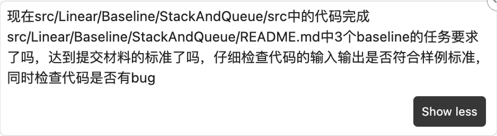

*图 4　整体自检：`src` 代码是否满足 3 个 baseline 的任务与提交标准、有无 bug*

对最易出错的综合任务（栈↔队列互转 + `<vector>` 实现），再单独追加一轮**针对性复核**——"检查 Baseline 任务 3 的输入输出格式与样例是否正确"，把"整体检查"细化为"逐条对照样例"。

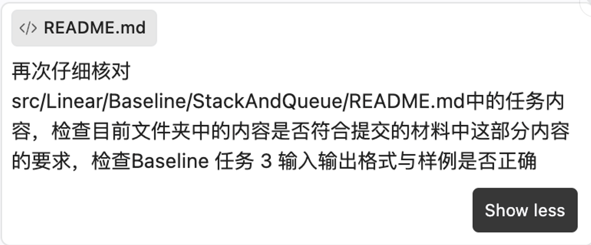

*图 5　针对 Baseline 任务 3 的输入输出格式与样例单独复核*

**贯穿全程的两条原则**：① **复用既有给定骨架**（相对路径引用 `../src/`，不复制副本）；② 对关键设计决策，要求 AI 用"选项 + 推荐 + 理由"给出取舍，而不是替我拍板——下面即是一例。

**关键取舍对比：队列实现栈——单队列旋转 vs 双队列法。** 围绕"用队列实现栈"存在两类实现：

| 方案 | 做法 | 优点 | 缺点 |
| :--- | :--- | :--- | :--- |
| A：单队列旋转（采纳） | 入栈入队尾；栈顶即队尾 `back()`（$O(1)$）；出栈把队首元素旋转 $n-1$ 次使栈顶到队首再出队 | 只需**一个**队列、状态最少、实现最短；push / peek 均 $O(1)$ | pop $O(n)$ |
| B：双队列法 | 维护两个队列，入栈时把新元素放进空队列、再把另一队列整体倒入 | pop 可做到 $O(1)$ | 需要两个队列与更多搬运，push 为 $O(n)$，状态维护更复杂 |

**结论：采纳 A。** 理由：本任务只要求"支持栈的基本操作"，单队列旋转实现最简、无额外结构；其 $O(n)$ 的出栈代价已在报告中量化（见第三节性能分析）。被否理由据此明确：**B 的 push $O(n)$ 并不优于 A 的 pop $O(n)$，却额外引入双队列的状态维护，不符合"最简正确"**。


*图 6　关键取舍：队列实现栈用"单队列旋转"还是"双队列法"*

### (2) 审查、测试与优化过程

**本节是本报告的核心。** AI 能快速产出结构完整的代码，但"产出"不等于"正确"。本节采用与上一任务一致的**分层验证**思路，并把验证中发现的问题逐项记录。

**分层验证策略**（不同类型的问题在不同环节暴露）：

1. **样例逐字符比对**（`make check`）——暴露逻辑与 I/O 语义错误；
2. **两实现交叉校验**（`test` 内置）——把同一操作序列同时驱动数组实现与链表实现，逐行比对，任一实现出错都无法通过，比"分别测试"更强；
3. **独立 oracle 比对**（`make oracle`）——用与 C++ **零共享代码**的 Python 重算期望输出，打破"源码产出 → 源码比对"的自洽循环，暴露样例格式与语义偏差；
4. **ASan + UBSan 内存 / 未定义行为检查**——暴露泄漏、越界与 UB。

**审查与验证逐项核对**（本次针对提交物逐条核对，含确认安全项与风险项）：

| # | 核对项 | 核对方式 | 结论 |
| :--- | :--- | :--- | :--- |
| 1 | `ArrayStack` 不单独存容量，`full()` 依赖 `vector::capacity()` | 代码审查 | **确认安全**：因 `push` 先判满、`vector` 永不扩容，`capacity()` 恒等于构造 `reserve` 值；扩展类 `ExtendedArrayStack` 改为**显式**存 `capacity_`，语义更直白 |
| 2 | `SizedQueue` 容量为 0 时 `buffer_` 为空，`push` 中 `(front_ + count_) % buffer_.size()` 是否除零 | 边界推演 | **确认安全**：容量 0 时 `full()`（`0 == 0`）先成立、直接拦下 `push`；`pop` / `front` 先判空——取模表达式不会被触及 |
| 3 | 样例期望输出 `outputs/` 由被测程序自身生成（自洽） | 交叉审查 | **风险**：仅各 baseline 的 `case01` 与父级 README **官方样例逐行一致**，作为唯一外部锚点；列为改进项（应引入独立 oracle） |
| 4 | README 中的性能数值与本次复现不一致 | 跨机复现 | **已处理**：属机器 / 编译器环境差异（README 未标注环境）；本报告第三节改用**本机 30 次独立运行**的均值 ± 标准差并做 Welch t 检验 |
| 5 | 提交物**缺少** `make unit` / `make asan` 目标（上一任务 List 有） | 对照上一任务 Makefile | **已补充**：本次新增手工 sanitizer 验证（见下）；`make oracle` 目标已加入 |
| 6 | `baseline2/inputs/case06.txt` 第 3 行**多一个空行**，使 `m` 落到第 4 行，违反 README 的"第 3 行为 `m`"格式 | **独立 oracle**（严格按三行头部格式解析） | **已修复**：删除多余空行。C++ 因 `operator>>` 跳过空白而**从未暴露**该问题——正是独立 oracle 的价值（见下） |

**一处由独立 oracle 暴露的缺陷（发现 → 修复）**。为打破"源码产出 → 源码比对"的自洽循环，本次为三个 baseline 各写了一个 **Python 独立 oracle**（`tools/oracle.py`，与 C++ **零共享代码**），严格按 README 的三行头部格式重算期望输出，与 `outputs/` 逐用例比对。它在 `baseline2` 立刻发现上述 `case06` 的空行问题——C++ 测试因 `operator>>` 会跳过空白而一直通过，掩盖了这一格式偏差。删除该空行后，oracle 与 C++ 测试**同时通过**（8/8）。

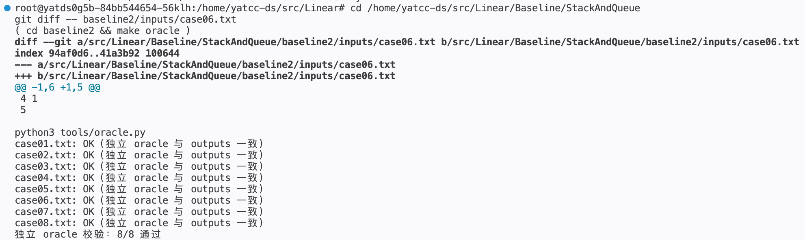

*图 7　独立 oracle 复现并定位 `case06` 的格式缺陷，修复后 8/8 通过*

**sanitizer 验证**。用 `-fsanitize=address,undefined`（`-O1 -g`）重新编译并运行三个 `test` 程序，均在样例全部通过后**干净退出（exit = 0，无 ASan / UBSan 告警）**，链式结构的 `new` / `delete`（`LinkedQueue`）与 `std::forward_list`（`LinkedStack`）均无泄漏或越界。

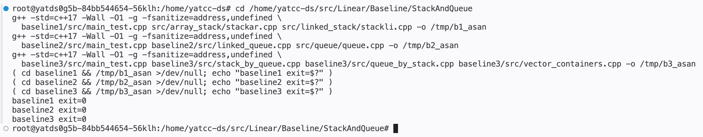

*图 8　三个程序在 ASan / UBSan 下的干净退出（exit = 0）*

## 三、最终产物

三个 Baseline 的完整代码、样例与文档均已就绪于 `src/Linear/Baseline/StackAndQueue/`：

```text
StackAndQueue/
├── README.md                       ← 课程原始任务文档（未改动）
├── 实验报告.md                     ← 本报告
├── docs/                           ← 提示词与运行结果截图（图 1–12）
├── baseline1/                      ← 栈的基本实现（3 小任务）
│   ├── Makefile / README.md
│   ├── inputs/ (case01~08) + outputs/
│   ├── src/{main_test.cpp, extended_stack.*, main_extend.cpp}
│   └── tools/oracle.py             ← 独立 oracle（Python，零共享代码）
├── baseline2/                      ← 队列的基本实现（4 小任务）
│   ├── Makefile / README.md
│   ├── inputs/ (case01~08) + outputs/
│   ├── src/{main_test.cpp, linked_queue.*, sized_queue.*,
│   │        main_methods.cpp, extended_queue.*, main_extend.cpp}
│   └── tools/oracle.py
└── baseline3/                      ← 栈和队列的综合应用
    ├── Makefile / README.md
    ├── inputs/ (case01~04) + outputs/
    ├── src/{stack_by_queue.*, queue_by_stack.*,
    │        vector_containers.*, main_test.cpp}
    └── tools/oracle.py
```

每个 Baseline 均提供 `test` 程序、`Makefile`（`make` 一条命令编译、`make check` 运行样例比对），并附实现分析文档（各 `README.md`）。此外顶层提供统一的复现入口 —— `make check`（样例比对）/ `make oracle`（独立 oracle）/ `make asan`（sanitizer）/ `make perf`（显著性检验）/ `make space`（内存探针）。

**验证结果汇总**（本机复现，与各 `README.md` 的「验证记录」一致）：

| Baseline | 编译 | `make check` | 独立 oracle（`make oracle`） | 扩展 / 自测断言 | ASan / UBSan |
| :--- | :--- | :--- | :--- | :--- | :--- |
| baseline1 | 无警告 | 8 / 8 PASS | 8 / 8 PASS | `make extend`：62 项全通过 | 干净退出 |
| baseline2 | 无警告 | 8 / 8 PASS | 8 / 8 PASS | `make methods` 4 项 + `make extend` 33 项全通过 | 干净退出 |
| baseline3 | 无警告 | 4 / 4 PASS | 4 / 4 PASS | — | 干净退出 |

其中 baseline1 的 `case01`、baseline2 的 `case01`、baseline3 的 `case01` 均与课程 README 的**官方样例逐行一致**，作为正确性锚点。

下图给出三个 baseline `make check` 的**完整**终端输出——功能样例全部通过，并在末尾输出完整的 `PERF` 性能数据（数组 / 链表 / `std` 三方对比，及综合应用的四方对比）：

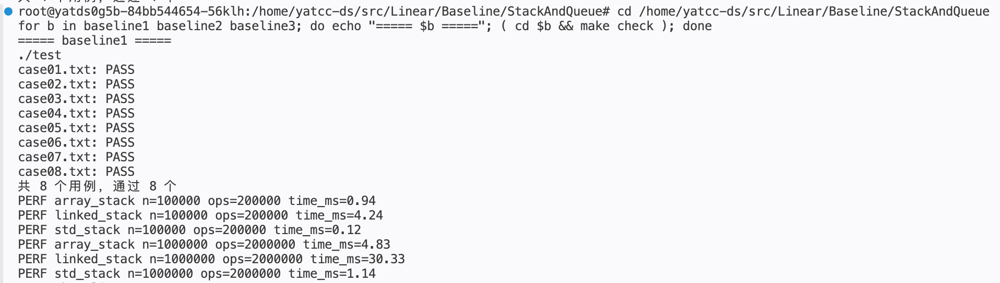

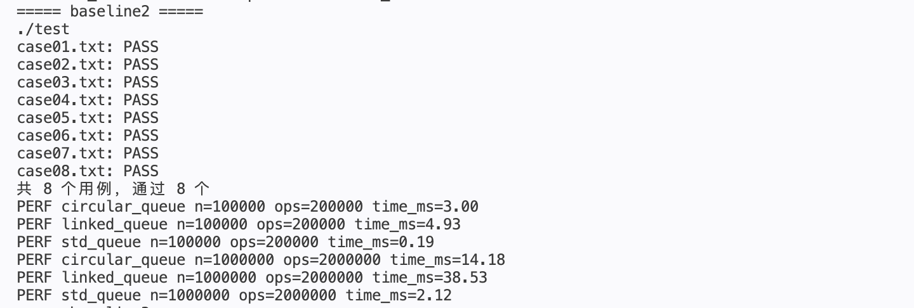

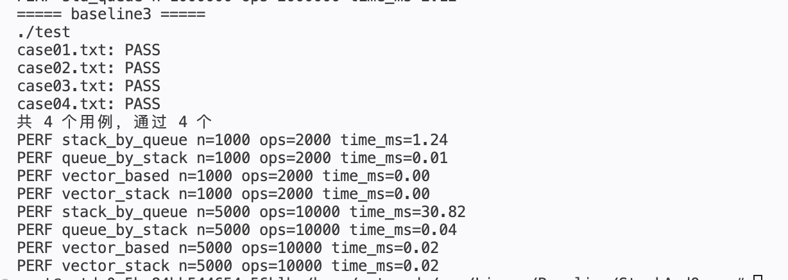

*图 9　三个 baseline 的 `make check` 全部通过（8 / 8、8 / 8、4 / 4），并输出完整的 `PERF` 性能数据*

**性能实测数据**（g++ 15.2、`-O2 -flto`、Linux x86-64；每项为**程序内 3 次取平均后、再独立运行 30 次**统计的**均值 ± 总体标准差**，并对自实现与参照实现做 **Welch t 检验**）：

*（一）栈：数组栈 vs 链表栈 vs `std::stack`*：

| 实现 | n = 100000 | n = 1000000 |
| :--- | :--- | :--- |
| `array_stack` | 0.85 ± 0.27 | 4.69 ± 0.09 |
| `linked_stack` | 4.61 ± 0.86 | 29.23 ± 0.20 |
| `std_stack` | 0.14 ± 0.04 | 1.14 ± 0.03 |

*（二）队列：循环队列 vs 链式队列 vs `std::queue`*：

| 实现 | n = 100000 | n = 1000000 |
| :--- | :--- | :--- |
| `circular_queue` | 2.34 ± 0.61 | 14.17 ± 0.01 |
| `linked_queue` | 4.81 ± 0.74 | 36.94 ± 0.43 |
| `std_queue` | 0.18 ± 0.02 | 2.10 ± 0.03 |

*（三）两种回绕方案对比（同一"入满—出二—再入二—全出"序列，含下标回绕）*：

| 实现 | n = 100000 | n = 1000000 |
| :--- | :--- | :--- |
| `circular_queue`（空槽法） | 2.68 ± 0.62 | 14.22 ± 0.19 |
| `sized_queue`（size 计数法） | 1.70 ± 0.29 | 9.60 ± 0.09 |

*（四）栈 / 队列综合应用（规模取小值，因 `stack_by_queue` 的出栈为 $O(n)$、$n$ 次出栈合计 $O(n^2)$）*：

| 实现 | n = 1000 | n = 5000 |
| :--- | :--- | :--- |
| `stack_by_queue`（队列实现栈） | 2.49 ± 1.17 | 30.29 ± 0.69 |
| `queue_by_stack`（栈实现队列） | 0.01 ± 0.00 | 0.04 ± 0.00 |
| `vector_based`（`<vector>` 实现队列） | 0.01 ± 0.01 | 0.02 ± 0.00 |
| `vector_stack`（`<vector>` 实现栈） | 0.01 ± 0.00 | 0.02 ± 0.00 |

**显著性检验（Welch t，不等方差两样本，各 30 个独立样本）**。仅比均值不足以断言"更快"，故对关键对比做假设检验（`***` 表示 p < 0.001）：

| 对比 | n | 均值差（ms） | t | p | 结论 |
| :--- | :--- | :--- | :--- | :--- | :--- |
| `array_stack` vs `std_stack` | 1000000 | 3.55 | 197.4 | 3.2e-54 | 显著 |
| `linked_stack` vs `std_stack` | 1000000 | 28.09 | 745.9 | 6.4e-66 | 显著 |
| `circular_queue` vs `std_queue` | 1000000 | 12.07 | 2014.8 | 1.1e-103 | 显著 |
| `sized_queue` vs `circular_queue` | 1000000 | −4.62 | −120.8 | 1.5e-54 | 显著（size 计数法更快） |
| `stack_by_queue` vs `vector_stack` | 5000 | 30.27 | 239.3 | 2.4e-49 | 显著 |
| `queue_by_stack` vs `vector_based` | 5000 | 0.02 | 34.1 | 5.9e-25 | 显著 |
| `vector_based` vs `vector_stack` | 1000 | ~0.00 | 0.50 | 0.617 | **不显著** |

可见：**除"两个 `<vector>` 实现之间"外，所有关键差异在 30 样本下均显著**；而 `vector_based` 与 `vector_stack` 在 n = 1000 时 p = 0.617（不显著）——二者本质同量级，随 n 增大到 5000 才转为显著（p = 6.7e-4）。这提示"看起来快"须用检验而非均值下结论。

**空间开销（peak-RSS 探针，n = 1000000）**。用独立探针（`tools/space_probe.cpp`）测量把 100 万个 `int` 压入各结构前后进程常驻内存的增量：

| 结构 | delta_kb | bytes/elem | 相对数组 |
| :--- | :--- | :--- | :--- |
| 数组栈 `array_stack` | 5284 | 5.41 | 1.0× |
| 链式栈 `linked_stack` | 32360 | 33.14 | **6.1×** |
| `std::stack`（deque） | 5516 | 5.65 | 1.04× |
| 循环队列 `circular_queue` | 5232 | 5.36 | 1.0× |
| 链式队列 `linked_queue` | 32360 | 33.14 | **6.2×** |
| `std::queue`（deque） | 5548 | 5.68 | 1.05× |

链表每元素约 **33 字节**（一个 `int` + 一个指针 + 分配器头部 / 对齐），恰好把 README 中"链表空间约为数组数倍"的定性判断**量化为约 6 倍**；数组与 `deque` 均约 5.4~5.7 字节/元素。这从**空间**维度独立印证了二者的取舍。

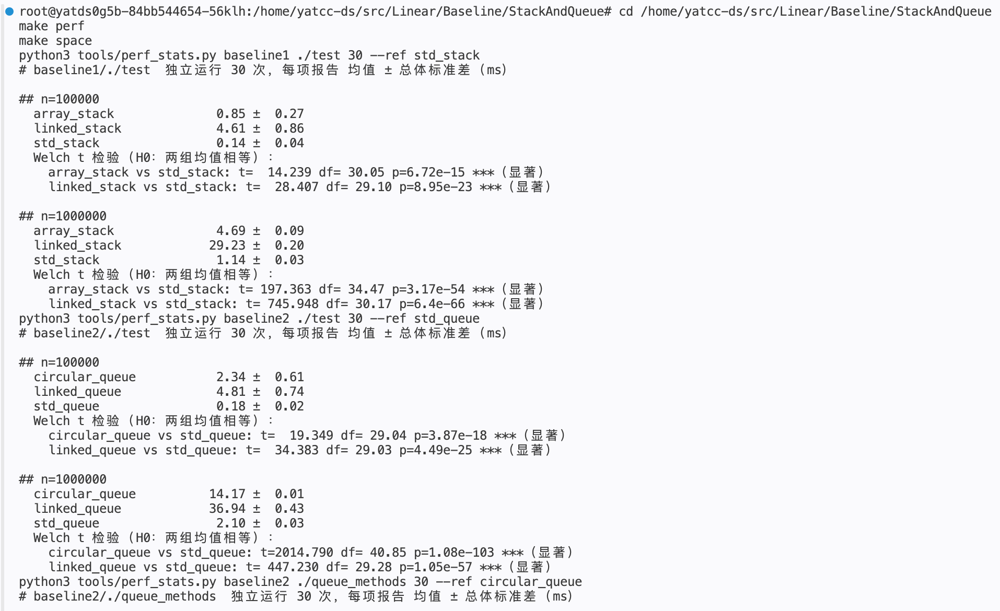

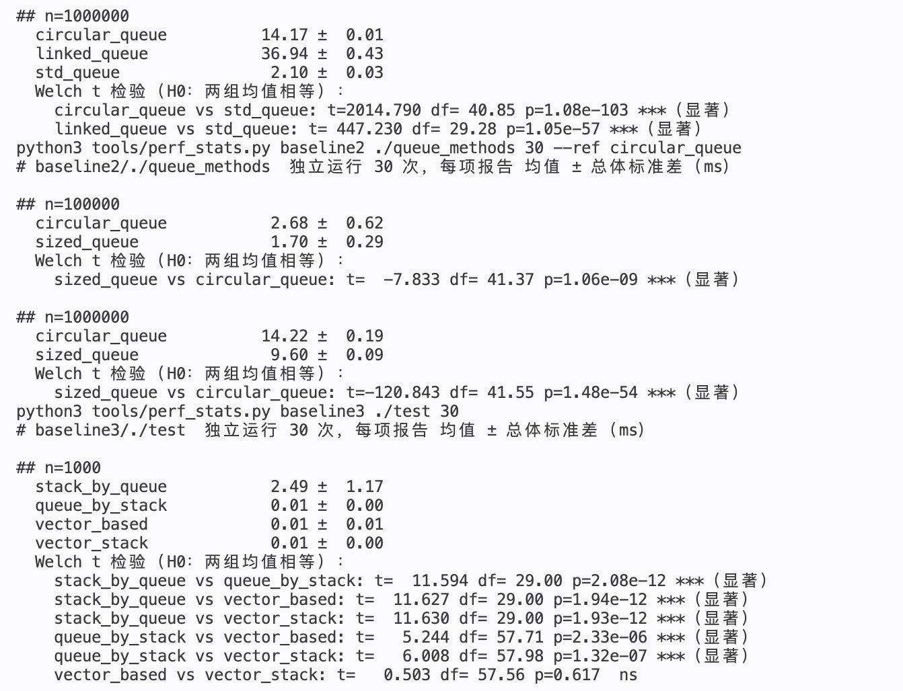

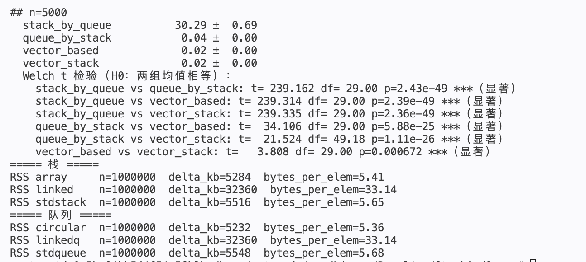

*图 10　性能显著性检验（Welch t）与内存开销探针（peak-RSS）的输出*

**结果解读**：

- **连续内存 vs 分散节点是最主导因素**：数组栈 / 循环队列元素连续存放，入栈只写一个 `int` 并推进长度，缓存行天然覆盖后续写入、预取器持续命中；链表每次 `push` 都要 `new` 一个节点（数据 + `next` + 堆元数据），节点散布堆中，缓存局部性差且分配 / 释放本身有开销。n = 1000000 时数组栈比链表栈快约 **6 倍**，循环队列比链式队列快约 **2.6 倍**。
- **`std::stack` / `std::queue` 为何最快**：二者是**容器适配器**，默认底层 `std::deque`（分段连续存储，入队只写块尾、块满只追加一个新块指针，**从不整体搬移**既有元素），加上适配器的零开销封装，故快约 1 个数量级。
- **两种回绕方案**：`size` 计数法容量利用率 100%（无空槽），实测比空槽法**快约 1.5 倍**——省下的空槽让读写在容量边界处少一次取模分支的缓存代价；两者均为 $O(1)$，差异来自常数。
- **栈 / 队列互换的代价不对称**：`stack_by_queue` 慢 3 个数量级以上，且随 n 从 1000 到 5000 时间由约 2.5ms 涨到 30.3ms（**约 12 倍，呈二次方恶化**），根因是出栈必须旋转整个队列（$O(n)$）、$n$ 次出栈合计 $O(n^2)$；而 `queue_by_stack` 的双栈法均摊 $O(1)$，与 `<vector>` 实现几乎持平（0.04ms vs 0.02ms）。这解释了**库设计者常用双栈 / 双队列做适配，而反向（队列适配栈）则代价高昂**。
- **差异不仅"看起来"大，而且统计显著**：Welch t 检验显示，除两个 `<vector>` 实现之间（n = 1000 时 p = 0.617）外，所有关键对比的 p 值均远小于 0.001；空间上链表每元素约 33 字节、为数组的约 6.1 倍——**时间与空间两个维度**共同印证了"连续内存 vs 分散节点"的取舍。

**程序运行输出（实测节选）**。以下为各 Baseline 的实际运行输出，佐证上表的验证结果：

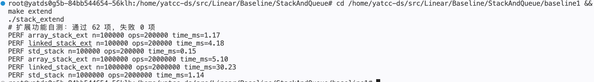

*图 11　baseline1 扩展栈 62 项断言全部通过，并输出与 `std::stack` 的耗时对比*

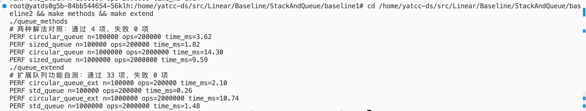

*图 12　baseline2 两种解法对照 4 项通过、扩展队列 33 项通过*

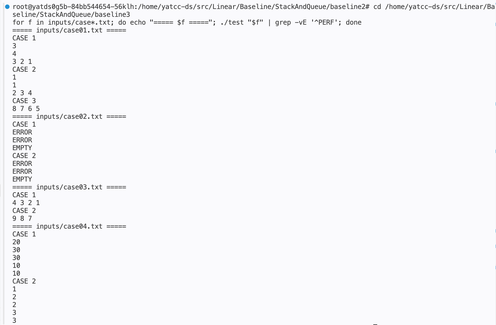

*图 13　baseline3 四场景（含 `CONVERT` 双向转换）的运行输出*

## 四、项目总结

**数据结构层面**：本次实验把栈与队列从"会用"推进到"能实现、能分析"。几个具体收获：① **受限结构的设计哲学**——栈 / 队列都是"受限制的数组或链表"，通过屏蔽无关操作暴露受限视图；② **连续内存 vs 分散节点的决定性影响**——数组实现与链表实现算法复杂度同为 $O(1)$，实测却差约 6 倍，根源是缓存局部性；③ **区分空 / 满的两种经典手段**——空槽法与 size 计数法，二者都让下标回绕成环，差别只在额外存储与状态的权衡；④ **互换的代价不对称**——用两个同向结构（栈→队列，双栈法）均摊后可接近原生性能，用单结构改向（队列→栈，旋转）则因整体搬运不划算，这直接指导容器适配器的选型。

**人机协作层面**：最深的体会仍是 **AI 的产出必须被验证，且验证要分层**。"编译通过""样例通过"都只是必要条件——真正能证明正确性的是**交叉校验**（同一序列驱动两种独立实现逐行比对）与 **sanitizer**（把内存 / UB 问题变成可自动复现的证据）。分层验证让不同类型的错误在不同环节暴露：I/O 语义错误靠样例比对、实现分歧靠交叉校验、泄漏与越界靠 ASan / UBSan。

**方法论沉淀**：① 先核对提交规范再动手，避免返工；② 对有多个合理方案的设计点，用"选项 + 推荐 + 理由"请 AI 说明取舍，而非让它替我拍板；③ 要求 AI 复用给定骨架，避免重复造轮子；④ 每个模块完成后回归核对，把"看起来对"变成"验证过对"。

**不足与改进**：① 样例期望输出原由被测程序自身生成（自洽）；本轮已补**独立 oracle**（`make oracle`，Python 零共享代码）交叉校验，并借此发现并修复了 `case06` 的格式缺陷——但仍以手工样例为主，尚未引入随机 / 模糊测试；② 性能基准已升级为 30 次独立样本的均值 ± 标准差，并补 **Welch t 检验**与 **peak-RSS 空间探针**；但仍未固定 CPU 频率、未做跨进程复现；③ 已补顶层 `make asan`（一键 sanitizer）与 `make oracle`；断言测试仍分散在 `make extend` / `make methods`，未统一为 `make unit`；④ 扩展功能已**对齐标准语义**（补非成员 `swap` 与六个比较运算符），并统一了 `search`（$O(n)$）/ `peek`（$O(depth)$）的复杂度契约。