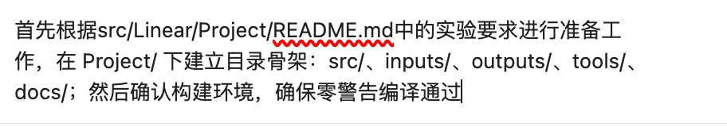
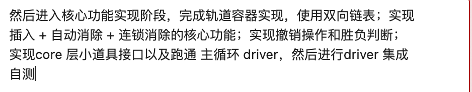
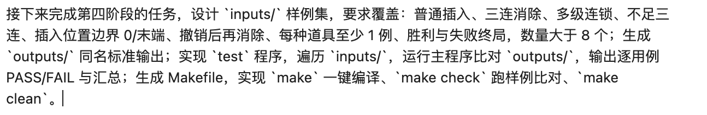
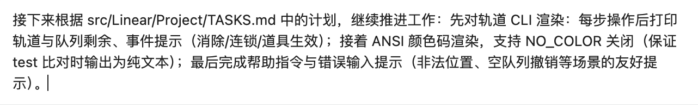
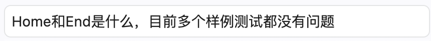
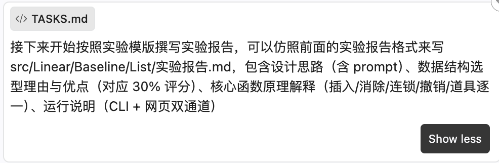
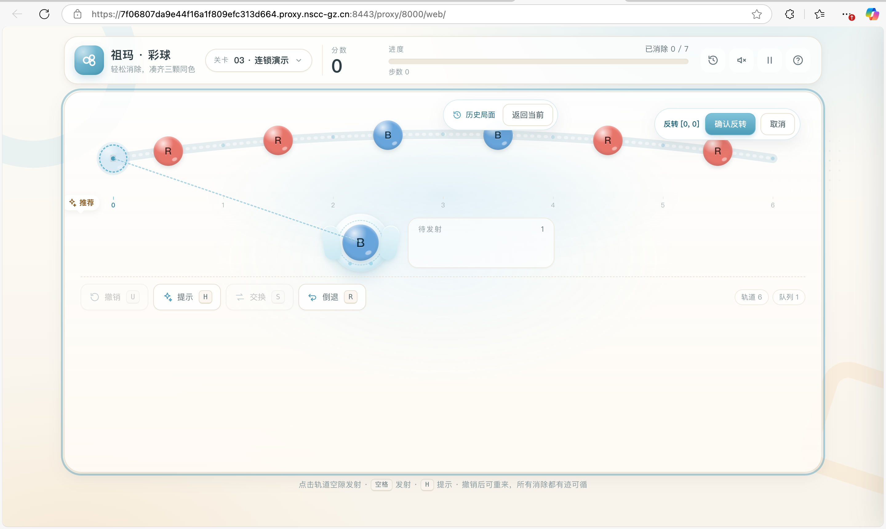
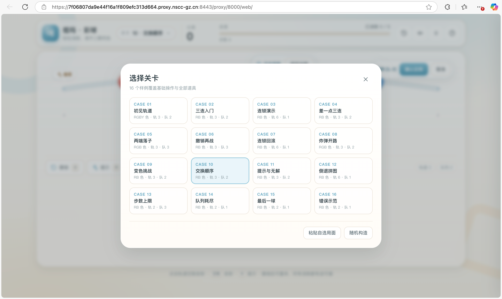
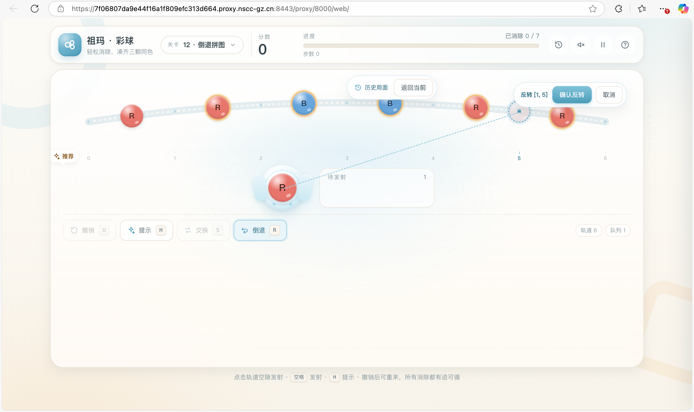
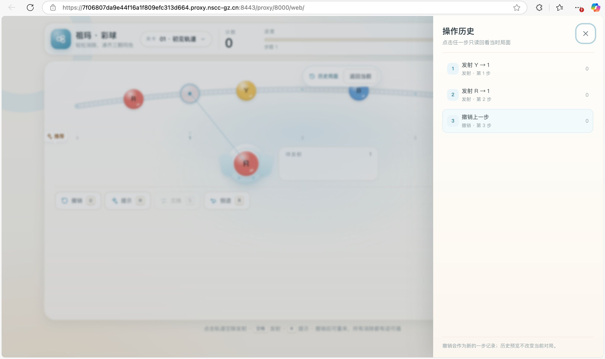

<div align="center">

# 中山大学实验报告

</div>

| 项目 | 内容 |
| :--- | :--- |
| 学院 | 计算机学院 |
| 课程名称 | 数据结构与算法（人机协作） |
| 题目 | 栈、队列和链表的综合应用：祖玛游戏（CLI + 网页双通道）实验报告 |
| 学号 | 24325187 |
| 姓名 | 刘雅静 |
| 专业名称 | 计算机科学与技术（人工智能与大数据方向） |
| 任课教师 | 郑馥丹 |
| 实验地点 | 实验中心E402 |
| 实验日期 | 2026年10月20日 --- 10月28日 |


---


## 目录

- [一、项目分析与设计](#一项目分析与设计)
  - [1.1 需求拆解与总体架构](#11-需求拆解与总体架构)
  - [1.2 数据结构选型与理由（30% 评分）](#12-数据结构选型与理由30-评分)
  - [1.3 规则、协议与功能设计](#13-规则协议与功能设计)
- [二、人机协作过程](#二人机协作过程)
  - [2.1 Prompt 设计与思路](#21-prompt-设计与思路)
  - [2.2 审查、测试与优化过程](#22-审查测试与优化过程)
- [三、核心函数原理解释](#三核心函数原理解释)
  - [3.1 轨道插入：定位与三种拼接情形](#31-轨道插入定位与三种拼接情形)
  - [3.2 消除：从变更点恢复不变量](#32-消除从变更点恢复不变量)
  - [3.3 连锁：拼缝 probe 的局部性](#33-连锁拼缝-probe-的局部性)
  - [3.4 撤销：命令模式与多区间逆序回填](#34-撤销命令模式与多区间逆序回填)
  - [3.5 道具逐一：炸弹、变色、交换、提示、倒退](#35-道具逐一炸弹变色交换提示倒退)
  - [3.6 胜负判定与计分](#36-胜负判定与计分)
- [四、运行说明（CLI + 网页双通道）](#四运行说明cli--网页双通道)
  - [4.1 构建与命令行通道](#41-构建与命令行通道)
  - [4.2 网页通道](#42-网页通道)
  - [4.3 验证命令一览](#43-验证命令一览)
- [五、最终产物与验证结果](#五最终产物与验证结果)
- [六、项目总结](#六项目总结)
- [参考资料](#参考资料)

---

## 一、项目分析与设计

### 1.1 需求拆解与总体架构

本项目是“栈、队列和链表”章节的综合应用，任务是用这三种数据结构实现祖玛游戏。与真实祖玛不同，本项目按课程要求做了简化：**轨道上的球不自动移动**，玩家从待发射队列取球，把球插入轨道指定位置；当轨道上出现连续 **≥3 颗同色球**时自动消除，消除后两段球拼接，如果拼缝再次形成 ≥3 同色段则继续**连锁消除**，直到轨道稳定。

我先把 README 的评分表和提交要求拆成可验证的功能点：

| README 要求 | 本项目实现 |
| :--- | :--- |
| 轨道初始化 | `Game` 构造函数建立 `DoublyLinkedTrack`，并对装载局面做一次 settle |
| 彩球发射、指定位置插入 | `SHOOT <pos>` → `Game::shoot()` → `Track::insert_at()` |
| 自动消除 | `settleFrom()` 检查插入点所在同色段 |
| 连锁消除 | 删除后以拼缝右侧节点为新 probe，循环至稳定 |
| 撤销 | 命令模式 `UndoEntry` + `LinkedStack`，支持连锁、道具、终局回退 |
| 胜负判断 | 轨道空 = WIN；队列耗尽或步数达到 LIMIT 且轨道非空 = LOSE |
| 用户交互 | CLI 纯协议/ANSI 渲染 + 独立静态网页游戏 |
| 代码质量 | core/driver 分层、协议文档、中文注释、分层测试 |

**总体架构**：

```text
                         ┌──────────────────────────────┐
inputs/*.txt ──────────> │ zuma（C++ driver）            │
                         │ protocol_io / cli_render      │
                         └───────────────┬──────────────┘
                                         │ Game 公共接口
                         ┌───────────────▼──────────────┐
                         │ core（零 IO 的规则引擎）       │
                         │  DoublyLinkedTrack            │
                         │  RingQueue<Ball>              │
                         │  LinkedStack<UndoEntry>       │
                         └──────────────────────────────┘

web/index.html ────────> app.js → view.js / controller.js → engine.js
                                        ↑
                                   protocol.js

test（C++）────────────> zuma --plain ──逐字节比对──> outputs/
web_crosscheck.js ──────> JS 引擎 ──逐事件比对──> zuma --plain
```

这样拆分的原因有三点：

1. **规则与 IO 分离**：`core` 不引用任何 IO 头文件，CLI 与 C++ 测试复用 core，网页按协议独立实现并交叉验证；
2. **测试可以分层**：core 单测直接构造 `Game`，driver 单测跑子进程，网页再做双实现交叉验证；
3. **呈现可以替换**：网页不是把 C++ 终端输出“搬”到浏览器，而是按协议独立实现一份 JS 引擎，再用 `webcheck` 把两份实现钉在同一份样例上。

对应评分表，本项目的证据分布如下：

| 评分项 | 本项目的对应内容 |
| :--- | :--- |
| 功能实现 30% | 必做七项全部实现；额外实现炸弹、变色、SWAP、HINT、REVERSE 五种道具；胜利/失败三条路径均有样例 |
| 数据结构设计 30% | 轨道双向链表、环形队列、链式栈撤销；有复杂度对比、选型理由与实现细节（见 §1.2、§3） |
| 用户交互 20% | 命令行协议/ANSI 双模式 + 可完整游玩的网页；网页有动画、历史回看、随机局面、响应式布局 |
| 代码质量 20% | core/driver/web 分层、协议契约、27 场景 core 测试、10⁵ 局随机差分、27 组 driver 测试、16 个样例逐字节比对、网页自动化验证 |

### 1.2 数据结构选型与理由

#### 1.2.1 轨道：自实现双向链表 `DoublyLinkedTrack`

祖玛轨道的核心操作不是“随机访问”，而是：

```text
定位插入点 → 插入一球 → 找同色段 → 删除一段 → 两段拼接 → 从拼缝继续找
```

这串操作天然适合链表。各候选结构的复杂度对比如下：

| 操作 | 双向链表（本项目） | 单向链表 | 顺序表 / `std::vector` |
| :--- | :--- | :--- | :--- |
| 已定位后插入一球 | **O(1)** | O(1)（需前驱） | O(n) 搬移 |
| 删除连续 k 球 | **O(k)** | O(k)，但找段左端需回溯 | O(n) 整体搬移 |
| 消除后两段拼接 | **O(1)**，改两个指针 | O(1)，但需前驱 | O(n) 搬移 |
| 连锁向拼缝两侧扩展 | **O(1)/步** | 只能单向走 | O(1) 下标，但删除代价大 |
| 下标 → 节点 | O(min(pos, n-pos)) | O(pos) | **O(1)** |
| 反转区间长度 L | **O(n+L)**，含下标定位；内部改链 O(L) | O(L)，但连接更绕 | O(L) 复制/搬移 |

**选择双向链表而不是顺序表**：顺序表唯一明显的优势是 O(1) 随机访问，但祖玛的插入和消除都会引发连续搬移；一次连锁可能删除多段，顺序表最坏会退化为 O(n²)。双向链表把“删除一段 + 拼接”变成指针操作，连锁每轮只需要沿 `prev/next` 向两侧走。

**为什么不用单向链表**：删除一段后，连锁检查的是“拼缝左侧末球”与“右侧首球”能否合并。单向链表没有 `prev`，要么额外保存前驱，要么从段右端绕回，逻辑更容易出错。双向指针让 `findColorRun()` 从 probe 同时向左右扩展，代码更直接。

**为什么不用哨兵节点**：本项目的轨道两端会频繁变化（头插、尾插、删到端点都会改变 `head_`/`tail_`）。哨兵能省掉部分空指针判断，但会引入“真实首节点是 `head_->next`”的额外心智负担；本项目选择**无哨兵**，用 `head_`/`tail_` 直接指向真实端点，并在 `insert_at`、`erase_run`、`reverse_range` 三处枚举端点分支。这样结构更贴近课程中“链表节点 + 头尾指针”的讲法，也便于用测试覆盖边界。

**尾指针的收益**：`SHOOT n`（尾插）是常见操作，`tail_` 让尾插不必从头遍历；`insert_at(size_, b)` 直接 O(1)。

轨道节点定义非常轻：

```cpp
struct TrackNode {
    Ball ball;          // Ball = char，普通球为字母，特殊球为 '*' / '?'
    TrackNode *prev;
    TrackNode *next;
};
```

节点直接持有 `Ball` 值，不再包一层抽象；颜色、特殊符号都是单字符，和协议文本可以直接互转。

#### 1.2.2 待发射队列：环形缓冲 `RingQueue<T>`

队列的访问模式是“队尾入、队首出、偶尔交换前两个、撤销时把球放回队首”。这是一个固定容量、只在头部附近变化的结构，适合**环形数组**：

```cpp
std::vector<T> buffer_;  // 固定容量
std::size_t front_;      // 队首下标
std::size_t back_;       // 队尾下一空位
std::size_t size_;
```

- `push()` / `take()` 都是 O(1)，通过取模回绕，不搬移元素；
- `unshift()` 撤销 SHOOT 时把 `front_` 逆推一格，O(1) 放回队首；
- `swap_front_two()` 只交换两个槽位，O(1)；
- `snapshot()` 非破坏性导出，供渲染与测试使用。

为什么不直接用 `std::deque` 或链队列？链队列每次 push/pop 都要分配/释放节点，而本项目的队列长度在装载时已知（容量 = 队列字符串长度），环形数组更省内存、缓存更友好。为什么不在 Baseline 的 `CircularQueue` 上直接加接口？因为 `take()`（取球即发射）、`unshift()`（撤销放回）、`swap_front_two()`（SWAP 道具）是祖玛专属语义，硬塞进通用队列会破坏原有接口的完整性；本项目保留 Baseline 的“固定容量 + front/back + full”设计语言，但实现一个语义更贴合游戏的模板类。

#### 1.2.3 撤销栈：项目内自实现链式栈 + 命令模式

撤销采用**命令模式**：每一步不是保存整条轨道的完整快照，而是保存“恢复这一步所需的全部信息”：

```cpp
struct UndoEntry {
    int op;                  // SHOOT / SWAP / REVERSE
    int pos, extra;          // 插入位置 / 反转区间
    Ball shotBall;           // 发射的原始球（含 '?' / '*'）
    struct RemovedRun {
        int left;            // 本轮消除段在消除前轨道中的左下标
        std::vector<Ball> balls;
    };
    std::vector<RemovedRun> removed; // 按发生顺序记录每轮消除
    std::int64_t scoreBefore;
    int movesBefore;
};
```

栈本体使用项目内的 `zuma::LinkedStack<UndoEntry>`，完整模板实现位于 `src/core/linked_stack.hpp`：

- 头节点为栈顶，按后进先出顺序保存撤销记录，不预设容量上限；
- `push/top/pop/empty` 的链操作为 O(1)，压入变长记录的复制成本另计 O(k)；
- 模板定义在头文件，无需外部源码、额外链接库或显式实例化单元；
- 禁止复制以避免节点重复所有权，析构以循环释放节点，避免深栈递归；
- `make stacktest` 验证空栈边界、LIFO、移动值、复制失败与十万节点析构；游戏原有撤销与跨语言测试继续验证语义。

为什么不用完整轨道快照？完整快照实现简单，但每一步都要复制 O(n) 个球；祖玛一局可能有几十步，撤销栈会变成 O(步数 × n) 的内存。用“操作参数 + 每轮被消球序列”可以把撤销记录压缩到只与**这一步实际消除的球数**相关；代价是撤销算法必须处理多轮区间坐标，这正是 §3.4 的核心难点。

#### 1.2.4 网页侧的数据结构

网页版不是把 C++ 代码编译成 WASM，而是按 `PROTOCOL.md` 独立实现了一份 JS 引擎。这样做的直接原因是网页要求 `file://` 直开、零构建、零服务器；如果引入模块打包或 WASM 构建链，部署复杂度会明显上升。

JS 引擎内部与 C++ 同构：

- 轨道节点对象 `{ id, color, prev, next, alive }`；`id` 是稳定编号，供动画层做“同一颗球的移动”而不是整轨重建；
- 队列是数组 `queueBalls`，队首在 `[0]`；
- 撤销记录同样是 `{ op, pos, shotBall, removed, scoreBefore, movesBefore }`；
- `_settleFrom()`、`_eliminateRun()`、`_refreshStatus()` 与 C++ 的 `settleFrom()`、`eliminateRun()`、`refreshStatus()` 一一对应。

独立实现的代价是“双实现漂移”风险。为此项目用 `tools/web_crosscheck.js` 把 16 个 `inputs/` 同时喂给 JS 协议引擎和 `./zuma --plain`，逐事件比对 header、READY、每轮 ELIM/TRACK、QUEUE、ERROR、HINT、终局行；网页侧的动画、音效、随机生成器不参与协议比对。这样既不牺牲网页的零依赖部署，又把规则一致性变成可自动检查的约束。

### 1.3 规则、协议与功能设计

#### 1.3.1 输入输出协议

所有实现方（C++ driver、`test`、JS 协议层、`outputs/`）以 [docs/PROTOCOL.md](docs/PROTOCOL.md) 为唯一契约。输入头部：

```text
COLORS RGBY
TRACK RRBBRR
QUEUE B
LIMIT 12        # 可选
READY
```

指令：

| 指令 | 语义 |
| :--- | :--- |
| `SHOOT <pos>` | 取队首球插入下标 `pos`，插入后新球位于 `pos`；`pos ∈ [0, n]` |
| `SHOOT <pos> <color>` | 仅当队首为变色球 `?` 时使用，落位瞬间定色 |
| `UNDO` | 撤销最近一步；可撤销终局步 |
| `SWAP` | 交换队列前两球 |
| `HINT` | 查询队首球的最优插入位置，不改变状态、不计步 |
| `REVERSE <i> <j>` | 反转轨道闭区间 `[i, j]`，随后检查消除 |
| `HELP` | 输出帮助，不改变状态、不计步 |
| `QUIT` | 按当前状态输出终局 |

位置统一 **0-based、从轨道左端起**；`SHOOT p` 表示插入后新球位于下标 `p`，即插到当前下标 `p` 的球之前；`p = n` 为尾插。

#### 1.3.2 道具设计

五种道具都落实为 core 层接口，并有独立样例：

| 道具 | 指令/符号 | core 接口 | 设计要点 |
| :--- | :--- | :--- | :--- |
| 炸弹球 | 队列含 `*`，`SHOOT p` | `settleFrom` 首轮特例 | 以炸弹为中心向两侧扩展到至多 3 球，无视颜色；后续连锁按普通规则 |
| 变色球 | 队列含 `?`，`SHOOT p c` | `Game::shoot(p, color)` | 落位瞬间定色；撤销时放回原 `?` 符号 |
| 交换 | `SWAP` | `RingQueue::swap_front_two()` | 只交换队列前两球，O(1)；交换两次即撤销 |
| 提示 | `HINT` | `Game::hint()` | 模拟 n+1 个插入位，返回立即消除球数最大的位置 |
| 倒退 | `REVERSE i j` | `DoublyLinkedTrack::reverse_range()` + 双拼缝 settle | 三指针原地逆置；反转后检查两个拼缝；各自独立连锁从第1轮开始 |

#### 1.3.3 状态与不变量

core 层把正确性锚定在四条不变量上：

- **U1**：轨道双向链表无哨兵，`head_`/`tail_` 同时为空或同时指向真实端点；
- **U2**：轨道上任意时刻不存在 ≥3 连同色段（装载、插入、反转后都必须 settle）；
- **U3**：分数非负，只在消除时按连锁倍率增加，UNDO 同步回滚；
- **U4**：合法 SHOOT/SWAP/REVERSE 步数 +1，UNDO 恢复步数，HINT/HELP 与非法指令不计步。

胜负状态只由三个谓词派生：轨道是否为空、队列是否为空、步数是否达到 LIMIT。没有额外“finished”布尔量，避免状态不一致：

```text
PLAYING ──轨道清空──────────→ WIN
        ──队列空且轨道非空──→ LOSE
        ──步数 ≥ LIMIT──────→ LOSE
        ──QUIT──────────────→ QUIT
WIN / LOSE ──UNDO──→ PLAYING（有记录）
QUIT ──协议结束
```

`refreshStatus()` 每次操作后重新判定；**WIN 优先于 LOSE**，所以“最后一步恰好清空轨道”仍判胜。

---

## 二、人机协作过程

### 2.1 Prompt 设计与思路

本次项目没有把“写一个祖玛”作为一次性大 prompt 交给 AI，而是**按阶段下达、每阶段给出验收标准**。这样做的好处是：每轮产出都能用命令或测试独立验收，出错时能把问题定位到某一层，而不是在一大段代码里猜。下面按实际推进顺序，把 11 张提示词截图放回对应阶段，说明每轮的目标、约束与产出。

#### 阶段 0：目录骨架与构建环境（图 1）




*图 1　阶段 0：目录骨架与零警告构建目标*

这一轮把“开始写代码”之前的环境与目录先固定下来：建立五个目录；Makefile 通过相对路径引用 Baseline 的 `stackli.cpp`；用 `g++ 15.2.0 -std=c++17 -Wall -Wextra` 验证零警告。准备工作还提前验证了 `LinkedStack<UndoEntry>` 的复用链路——显式实例化必须放在能看到成员函数定义的编译单元，因此专设 `src/linked_stack_undo.cpp` include `stackli.cpp` 做定义侧实例化（详见 [docs/stage0.md](docs/stage0.md)）。这一步避免了“代码写完才发现模板链接不上”的返工。

#### 阶段 1：设计定稿与核心算法（图 2）


*图 2　阶段 1：详细设计与核心算法落地*

这一轮没有先写 driver，而是先把“规则与结构”钉死：轨道采用双向链表、待发射队列采用环形缓冲、撤销采用命令模式（[docs/design.md](docs/design.md) §2）；同时把输入输出固化为 [docs/PROTOCOL.md](docs/PROTOCOL.md) v1.0，并实现消除与撤销。设计阶段的验收不是“能跑”，而是可验证：首轮 core 自测 20 场景通过（后续扩展为 27 场景），撤销另用 10⁵ 次随机差分验证“操作到任意步再撤销到底，轨道、队列、分数、步数精确还原”（现已入库为 `make difftest`）。

#### 阶段 2：核心功能与 driver（图 3）




*图 3　阶段 2：core 功能闭环与 driver 集成自测*

这一轮把核心功能串成闭环：`DoublyLinkedTrack` 提供定位插入、删除连续段、两段拼接与区间反转；`Game::settleFrom()` 从变更点出发完成自动消除与连锁；`UndoEntry` 记录“操作参数 + 每轮被消球序列”，由 Baseline `LinkedStack` 保存；五种道具落到 core 接口；最后用 driver 读指令、调 core、按协议输出。验收标准是 README 示例 `R R B B B R R → 空`、core 自测（当时 20 场景，现为 27 场景）、10⁵ 随机差分（现由 `make difftest` 复现），以及首轮 15 个 driver 用例子进程逐字节比对通过（后续扩展到 21 个）。

#### 阶段 3：CLI 渲染与交互契约（图 4）



*图 4　阶段 3：CLI 渲染与交互契约*

这一轮把 CLI 从“能跑”推进到“可读且不破坏契约”。截图中的三项要求分别对应：每步操作后打印轨道与队列剩余、消除/连锁/道具生效提示；用 ANSI 颜色码增强可读性，并可由 `NO_COLOR` 关闭以保证 `test` 比对为纯文本；对非法位置、空撤销栈等错误给出可操作建议，同时补上 `HELP`。实现上把渲染抽成 `cli_render`，交互提示只在 TTY 或 `--ui` 下出现，纯协议模式保持 `PROTOCOL.md` 原文；大小写不敏感与“非法指令零副作用”也在这一轮落地（协议升至 v1.1），记录见 [docs/stage3.md](docs/stage3.md)。

#### 阶段 4：样例集、test 与构建（图 5）



*图 5　阶段 4：从功能正确到样例可复现*

样例这一轮把“功能正确”转化为“样例可复现”。截图要求的覆盖点逐项落到 16 个样例：普通插入、三连消除、多级连锁、不足三连、插入位置边界 `0`/末端、撤销后再消除、五种道具各至少一例、胜利与失败终局。样例不是只挑顺利路径：`case09` 专门把“变色球非法颜色 → 合法定色 → 普通球误带颜色 → 队列耗尽判负”串在一条输入里，用来锁定“非法指令零副作用”；`case13` 用 `LIMIT` 判负；`case16` 用越界发射和空撤销栈验证不计步。最终形成同名 `outputs/`、`test` 逐用例 PASS/FAIL 比对程序，以及支持 `make`、`make check`、`make clean`（另有 `make samples` 重建标准输出）的 Makefile，并用 ASan/UBSan 全量复查。

#### 阶段 5a：网页视觉设计（图 6）


*图 6　阶段 5a：网页视觉与交互规范定稿*

这一轮先产出设计文档，而不是直接写页面。截图中的暖白/浅米色背景、天空蓝辅助色、低饱和球体、浅色凹槽轨道、圆角控件，以及“顶部展示关卡、分数和进度，暂停/音效放在角落”的布局要求，都先在 [docs/web-design.md](docs/web-design.md) 固化为设计令牌；同时确定页面结构、组件规格、动画、键盘与响应式断点，再进入实现。这样后续调整视觉时不会牵动规则代码。网页定位为独立的 `Project/web/` 静态页面，采用经典 `<script>` + `window.Zuma`，以避开 `file://` 下 ES module/fetch 的限制。

#### 阶段 5b：网页实现、整合与测试（图 7）


*图 7　阶段 5b：网页实现、整合与测试*

这一轮明确要求“页面骨架 + 引擎接入 + 动画交互 + 整合测试”四件事一起收口，避免出现“页面能打开但规则不对”或“规则对但页面不能玩”的半成品。最终网页拆成 7 个经典脚本：`engine → protocol → samples-data → audio → controller → view → app`，既避开 `file://` 下 ES module/fetch 的限制，又保持规则、协议、控制、视图分层。验收由 `make webverify` 串联：C++↔JS 交叉验证 16/16、JS 单测（当时 18 项，现为 25 项）、静态检查 16 项、DOM 冒烟 10 组。

#### 阶段 5c：人工自测与可用性修正（图 8–10）

##### （1）先要自测清单，不先要结论（图 8）


*图 8　阶段 5c：人工网页自测的提问*

这不是一条“继续写代码”的 prompt，而是要求把自动化验证之外的验收方法讲清楚。回答没有把 DOM shim 的结果冒充成视觉验收，而是明确区分：`webdom` 只证明脚本装配与状态流转，真实浏览器中的布局、缩放、`file://` 直开、焦点顺序、色盲模拟需要按 [docs/web-test.md](docs/web-test.md) §2 的浏览器清单逐项确认。由于当时的开发环境是 code-server 容器，`file://` 与 `localhost:8000` 都指向用户本机而非容器，随后又补充了“在项目目录启动静态服务器 + 使用平台端口代理”的打开方式，避免把环境问题误判成网页缺陷。后续（2026-10-29）容器内装好 Playwright + Chromium 后，§5.4 已把这份清单中的大部分项目转为真实浏览器自动检查。

##### （2）快捷键语义不清（图 9）


*图 9　阶段 5c：快捷键语义的提问*

`Home`/`End` 原本用于把插入位光标直接跳到轨道首/尾（即插入下标 `0` 与 `n`）。它们虽然写在快捷键说明里，但对不熟悉终端快捷键的玩家不够直观；我同时确认“多个样例测试都没有问题”，说明这不是规则或状态缺陷，而是**可发现性与操作习惯**的问题。这个区分很重要：它把修改范围限定在交互层，不需要动 core 与协议。

##### （3）快捷键与页面比例一起修正（图 10）



*图 10　阶段 5c：快捷键与页面比例的修正*

这一轮是典型的“功能正确但体验不对”的反馈。处理时没有只改 CSS 的一个数值：

- 快捷键：`1`/`0` 跳到首/尾，`Home`/`End` 保留为兼容别名；变色球调色板打开时 `1`–`8` 仍优先选色，避免与跳转冲突；同步更新 `index.html` 帮助、`docs/web-design.md`、`docs/web-test.md` 与 `web_dom_smoke.js`；
- 页面比例：把主区最大宽度调到 1232 px、球径 48 px、轨道节距 62 px，并同步放大 HUD、发射器、队列、按钮、弹窗与历史抽屉，压缩四周留白；`view.js` 的轨道布局常数与 `app.css` 一起调整，而不是给整个页面加一个 `zoom`；
- 回归：重新执行 `make check`、`make webverify`，确认 C++ 样例与网页双实现仍然一致。

#### 阶段 6：报告撰写（图 11）



*图 11　阶段 6：按既有实验报告格式组织本次报告*

这一轮把“代码与测试”转化为“可评阅的文档”：沿用此前 List 实验报告的章节结构（历史参考，不作为提交依赖），重点补齐评分表对应的证据——数据结构选型与复杂度对比、核心函数逐项原理、CLI 与网页双通道运行说明，以及可复现的验证结果。本次整理即按这一要求，把 11 张 prompt 截图按阶段归位，并围绕截图内容重写过程叙述，而不是把截图简单堆在章节末尾。

**Prompt 策略小结**：

1. **以仓库文档为上下文**：每次先指向 `TASKS.md`、`README.md`、`PROTOCOL.md`，让 AI 在既有约束内工作，而不是生成通用模板；
2. **每轮给出可验收的完成条件**：例如“16 个样例”“`make check` 逐字节比对”“`webcheck` 双实现一致”，而不是只说“做得好看一点”；
3. **先设计后实现**：网页先产出设计文档，再写页面；数据结构先做选型对比，再写代码；
4. **要求分层验证**：core 自测、driver 集成、样例比对、网页双实现交叉验证，各自覆盖不同缺陷类型；
5. **把体验问题当作需求输入**：Home/End 的语义、110% 缩放才舒服，都不是测试能自动发现的；我给出具体现象与期望后，AI 负责把修改落实到代码、文档与回归测试；
6. **保留人工判断**：视觉比例、快捷键是否顺手、交互是否符合直觉，最终由实际使用者反馈决定。

### 2.2 审查、测试与优化过程

AI 能快速产出结构完整的代码，但“能编译”不等于“正确”。本项目在开发过程中发现并修复了多处缺陷，下面按“发现方式 → 根因 → 修复”记录其中最有代表性的几项：

| # | 缺陷 | 发现方式 | 根因与修复 |
| :--- | :--- | :--- | :--- |
| 1 | `REVERSE` 双拼缝 probe 越界 / use-after-free | 开发阶段 10⁵ 局随机差分 + ASan | 反转后两个拼缝分别 settle；第一次 settle 可能删短/删空轨道，第二次再按下标 `at(i-1)` 会越界；改为先取节点指针，第二次调用前用 `nodeAlive()` **只比较指针值、不解引用**，被删则跳过（该版第二个 probe 仍取在左拼缝，见缺陷 7） |
| 2 | `ElimEvent.balls` 为空（move-after-use） | driver 集成测试首次消费该字段 | `eliminateRun` 先把 `RemovedRun` move 进撤销记录，再用 `run.balls` 构造事件；move 后源对象已空。修复为先构造事件，再 move |
| 3 | 头部三行后立即 EOF 被误判为“头部不完整” | driver 集成测试 | 合法输入（装载即终局、无指令）被拒绝；修复为 EOF 时若已到达 `LIMIT/READY` 阶段即合法 |
| 4 | `UNDO` 无法从 WIN/LOSE 回退 | driver 集成测试 | 主循环在终局后直接退出；修复为终局只打印终局行、循环继续，UNDO 成功后复位终局标记，再次终局时重新打印 |
| 5 | 变色球颜色非法时队首球被吞 | 零副作用专项用例 | `shoot()` 先 `take()` 再校验颜色；修复为先 `front()` 校验、通过后再 `take()`，保证非法指令不改变任何状态 |
| 6 | C++ `Game::swap()` 未刷新 LIMIT 终局 | 网页双实现交叉验证 | SWAP 也消耗一步，可能触发 LIMIT；C++ 补 `refreshStatus()`，与 JS 引擎一致 |
| 7 | `REVERSE` 右拼缝漏消（反转后轨道仍留 ≥3 同色段） | `make difftest` 新增的 U2 不变量断言（第 123 局） | 缺陷 1 的修复把第二个 probe 取成 `probeA->prev`，与第一个 probe 同处左拼缝；`j/j+1` 右拼缝成三连时不会消除。修复为 `probeB = at(j)`（C++/JS 同步），并补右拼缝回归用例 |

这些缺陷说明了一件事：**单元测试全绿不等于系统正确**。缺陷 1 只在“反转后第一次 settle 恰好删空/删短轨道”的窄条件下触发；缺陷 2 只有在 driver 真正读取 `balls` 字段时才暴露；缺陷 5 只有断言“非法指令后继续发射”的后续状态时才暴露。因此本项目采用多层验证，让不同类型的问题在不同层面暴露：

| 验证层 | 命令 | 覆盖内容 | 当前结果 |
| :--- | :--- | :--- | :--- |
| core 场景自测 | `make selftest` | 装载消除、单消、连锁、撤销、炸弹、变色、SWAP、REVERSE（含右拼缝）、HINT、LIMIT、34/60 轮深连锁、终局守卫等 | 27 场景 PASS |
| core 随机差分 | `make difftest` | 随机 SHOOT/SWAP/REVERSE：U2、非法零副作用、分数增量、撤销还原、重放确定性 | 100000 / 100000 PASS |
| driver 集成 | `make drivertest` | 协议回显、错误短语、终局、HELP、大小写、NO_COLOR/UI、颜色开关 | 27 用例 + 4 项颜色断言 PASS |
| 样例逐字节比对 | `make check` | 16 个 `inputs/` 与 `outputs/` 全量比对 | 16 / 16 PASS |
| JS 协议交叉验证 | `make webcheck` | JS 引擎 vs `./zuma --plain`，逐事件 token 比对 | 16 / 16 PASS |
| JS 引擎单测 | `make webtest` | 引擎/协议/Controller；400 局随机操作全量撤销还原；深连锁饱和与右拼缝回归 | 25 项 PASS |
| 网页静态检查 | `make webstatic` | 必需文件、110 个 id、脚本顺序、本地资源、SVG、语法、CSS/HTML 结构 | 16 项 PASS |
| DOM 集成冒烟 | `make webdom` | app/view 主流程（装载、发射、撤销、历史、关卡、暂停、LIMIT、随机） | 10 组 PASS |
| ASan/UBSan | 手工重编译（`-fsanitize=address,undefined`） | 16 个样例 + 27 场景自测 + 5000 局随机差分 | 无 sanitizer 报告，输出一致 |

补充说明：10⁵ 局随机差分已正式入库为 [tools/random_diff.cpp](tools/random_diff.cpp)，`make difftest` 以固定种子 20251020 复现（`DIFF_N=1000` 可缩短）。每局随机生成轨道/队列并执行 0~6 步 SHOOT/SWAP/REVERSE，断言 U2、非法操作零副作用、分数增量等于事件和、全量撤销精确还原、重放确定性。它最初发现了缺陷 1；2026-10-28 新增 U2 断言后又抓到缺陷 7（右拼缝漏消）。日常可复现的验证为 `make selftest` 27 场景、`make difftest` 10⁵ 局与 `make webtest` 25 项（含 400 局 JS 随机撤销）。

**测试策略的经验**：

- 先用样例比对锁定“输入输出语义”，再用 core 单测锁定“边界与不变量”，最后用 ASan 锁定“内存安全”；
- 对网页这种双实现，交叉验证比“两边各自测试”更强：同一份输入、同一个事件序列，任何一边漂移都会立刻暴露；
- 对交互层，DOM shim 只能验证脚本装配和状态流转，不能替代真实浏览器的布局、CSS 和视觉验收；本项目因此在 [docs/web-test.md](docs/web-test.md) §2 补充了真实 Chromium 自动验收（62/62），并把跨浏览器、屏幕阅读器等仍无法自动化的项目留在 §2.4 人工清单。

---

## 三、核心函数原理解释

### 3.1 轨道插入：定位与三种拼接情形

`DoublyLinkedTrack::insert_at(pos, ball)` 负责“把球插入到下标 `pos`，插入后新球位于 `pos`”。位置语义与协议一致：`pos ∈ [0, size]`，`pos = size` 为尾插，`pos = 0` 为头插。

```cpp
TrackNode *DoublyLinkedTrack::insert_at(std::size_t pos, Ball b)
{
    if (pos > size_) throw std::out_of_range("插入位置越界");
    TrackNode *node = new TrackNode(b);

    if (pos == 0) {                    // 头插：改 head_
        node->next = head_;
        if (head_) head_->prev = node;
        head_ = node;
        if (!tail_) tail_ = node;
    } else if (pos == size_) {         // 尾插：tail_ 让 O(1)
        node->prev = tail_;
        tail_->next = node;
        tail_ = node;
    } else {                           // 中间插：插到当前 pos 节点之前
        TrackNode *succ = at(pos);
        node->prev = succ->prev;
        node->next = succ;
        succ->prev->next = node;
        succ->prev = node;
    }
    ++size_;
    return node;
}
```

关键点：

- **头插/尾插 O(1)**：直接维护 `head_`/`tail_`，不需要遍历；
- **中间插 O(min(pos, n-pos)) + O(1)**：`at(pos)` 从较近的一端走，找到 `succ` 后只改四条指针；
- **为什么返回新节点指针**：`Game::shoot()` 需要把新节点作为 `settleFrom()` 的 probe，避免插入后再按颜色/下标找回节点；
- **空表处理**：`pos == 0` 且 `tail_ == nullptr` 时同时设置 `tail_`，保证 U1。

`at()` 的实现也体现了双向链表的优势：如果 `pos < size - pos` 从 `head_` 正向走，否则从 `tail_` 反向走，最坏走 `min(pos, n-pos)` 步。顺序表虽然 O(1) 定位，但后续删除/拼接要搬移，整体并不占优。

### 3.2 消除：从变更点恢复不变量

#### 3.2.1 不变量 U2

消除算法的核心不变量是：

> **U2：轨道上任意时刻不存在连续 ≥3 颗同色球。**

装载时先做一次 settle（消除初始轨道中已有的 ≥3 同色段，不计分、不可撤销）；之后任何改变轨道的操作（SHOOT / REVERSE）都必须调用 `settleFrom()`，把轨道带回 U2。

#### 3.2.2 找同色段

`findColorRun(node, segLeft, segRight)` 从 probe 向左右两侧扩展：

```cpp
segLeft = segRight = node;
while (segLeft->prev && segLeft->prev->ball == node->ball)
    segLeft = segLeft->prev;
while (segRight->next && segRight->next->ball == node->ball)
    segRight = segRight->next;
```

由于双向链表同时有 `prev`/`next`，这一步不需要额外数组，也不需要用下标回扫。

#### 3.2.3 删除一段

`eliminateRun(segLeft, segRight, len, round, events, undoEntry)` 负责：

1. 记录本轮消除段在**本轮消除前轨道**中的左下标 `run.left`；
2. 记录被消球的颜色序列 `run.balls`；
3. 生成 `ElimEvent`（轮次、左下标、数量、得分、球串、消除后轨道快照）；
4. 按 `count × 10 × 2^(round-1)` 加分；
5. 把 `run` 移入撤销记录；
6. 调用 `track_.erase_run()` 删除 `[segLeft, segRight]`；
7. 返回拼缝右侧首节点 `after`，供连锁继续。

`erase_run` 先保存 `before = start->prev`，沿 `next` 删除 k 个节点，再把 `before` 与区间右侧 `cur` 接起来；如果 `before` 为空则更新 `head_`，如果 `cur` 为空则更新 `tail_`。整个过程只改常数条指针，不搬移其他球。

```cpp
TrackNode *before = start->prev;
TrackNode *cur = start;
for (std::size_t i = 0; i < k; ++i) {
    TrackNode *next = cur->next;
    delete cur;
    cur = next;
}
size_ -= k;
if (before) before->next = cur; else head_ = cur;
if (cur) cur->prev = before; else tail_ = before;
return cur; // 拼缝右侧首节点
```

注意：被删节点的内存立即释放，因此撤销记录必须在删除前保存 `balls`，不能事后访问已释放节点。

### 3.3 连锁：拼缝 probe 的局部性

一次消除后，新的可能消除点**只可能在拼缝处**：被删段左侧的球与右侧的球现在相邻。取 `probe = segRight->next`（拼缝右侧首节点），下一轮 `findColorRun()` 从它向左右扩展，就自然覆盖了“左段末 + 右段首”的合并段。

```cpp
void Game::settleFrom(TrackNode *probe, ...)
{
    int round = 0;
    while (probe) {
        ++round;
        findColorRun(probe, segLeft, segRight);
        len = runLength(segLeft, segRight);
        if (len < 3) break;            // 稳定，U2 恢复
        probe = eliminateRun(segLeft, segRight, len, round, ...);
    }
}
```

以 README 示例 `R R B B B R R` 为例：

```text
装载后：R R B B B R R
          ↑     ↑
        段 BBB，长度 3 → 删除
拼缝：  R R | R R  → 相邻后变成 R R R R
probe = 拼缝右侧首 R → 段长 4 → 删除
轨道空 → WIN
```

**局部链操作与完整事件的成本**：U2 允许查段与删除围绕拼缝进行，这部分成本与删除球数 d 和轮数 r 成正比。但每轮 `index_of()` 扫描下标、`trackString()` 保存完整剩余轨道均需 O(n)，因此含初始定位的完整操作是 O(n+d+rn)，最坏 O(n²)；完整事件存储也可能是 O(d+rn)。协议每轮输出完整轨道，本身就有相应输出量，不能把仅链操作的 O(n) 作为整步复杂度。

**炸弹球的首轮特例**：如果 probe 是 `*`，第一轮不走同色匹配，而是以炸弹为中心向两侧扩展到至多 3 球：

```text
先向右扩一格，再向左扩一格，直到长度 3 或两侧都到端点
```

这样 `R * G` 会消除 `R*G` 三球；如果炸弹在端点，则消到端点为止，至少消炸弹自身。炸弹只在首轮生效，后续连锁的 probe 已经是拼缝右侧的普通球，按普通规则继续。

### 3.4 撤销：命令模式与多区间逆序回填

#### 3.4.1 为什么不能只记一个区间

一次 SHOOT 可能引发多轮连锁。每轮消除的区间坐标都基于**当时**的轨道状态：

```text
第 1 轮删除 [2, 4] 后，轨道长度变了；
第 2 轮删除的 [0, 3] 是相对于“第 1 轮删除后的轨道”的坐标。
```

因此不能用单一“消除区间”表示整步操作。`UndoEntry.removed` 按发生顺序保存每轮的 `{left, balls}`，撤销时**逆序**回填。

#### 3.4.2 逆序回填的归纳证明

设共 n 轮消除。

- 第 n 轮（最后发生）的区间基于“前 n-1 轮都已完成”的轨道，而撤销开始时轨道正是这个状态；因此在当前轨道下标 `removed[n-1].left` 处插入 `removed[n-1].balls`，轨道恢复到“第 n 轮消除前”。
- 此时第 n-1 轮的 `left` 坐标重新有效；回填第 n-1 轮后，轨道恢复到“第 n-1 轮消除前”。
- 依此类推，回填完第 1 轮后，轨道恢复到“发射球已插入、但尚未消除”的状态。

```cpp
for (std::size_t k = entry.removed.size(); k-- > 0;) {
    const auto &run = entry.removed[k];
    TrackNode *anchor = run.left < track_.size()
                      ? track_.at(run.left) : nullptr;
    track_.insert_before(anchor, run.balls.c_str());
}
```

`insert_before(anchor, balls)` 把整串球依次插到 `anchor` 之前；`anchor == nullptr` 表示尾插。由于每轮插入的是连续段，回填后各轮坐标正好对齐。

#### 3.4.3 删除发射球与放回队列

回填完消除段后，轨道处于“发射球已插入、尚未消除”的状态。接下来：

- 如果发射球**未参与消除**，它仍在当前下标 `pos` 处；
- 如果发射球**参与了消除**，它已经随某一轮 `removed.balls` 回填到段中，此时下标 `pos` 处的球与“未插入发射球”状态只差这一颗。

两种情形统一处理为“删除当前下标 `pos` 处的球”，然后 `queue_.unshift(entry.shotBall)` 把原始球（包括 `?` 或 `*` 符号）放回队首。这样撤销后队列与轨道都回到操作前。

```cpp
if (entry.pos < track_.size())
    track_.erase(track_.at(entry.pos));
queue_.unshift(entry.shotBall); // 变色球恢复为 '?'
```

#### 3.4.4 三类操作的撤销

| 操作 | 撤销动作 |
| :--- | :--- |
| SHOOT | 逆序回填消除段 → 删除 `pos` 处发射球 → `unshift` 原始球 |
| SWAP | 再次交换队首两球（交换自反） |
| REVERSE | 逆序回填消除段 → 再次反转同一区间 `[pos, extra]`（反转自反） |

撤销开始时先恢复 `score_ = entry.scoreBefore`、`moves_ = entry.movesBefore`、`status_ = kPlaying`，最后 `refreshStatus()`。因此从 WIN/LOSE 回退后，游戏可以继续；再次终局时会重新输出终局行。QUIT 则直接结束协议输入处理。

**复杂度**：设 n 为本步最大轨道长度、d 为被删球数、r 为被删段数、L 为反转区间长度。每段回填都可能重新 `at(left)` 定位，SHOOT 撤销为 O(d+(r+1)n)；REVERSE 撤销为 O(d+(r+1)n+L)。C++ SWAP 撤销为 O(1)；JS Controller 还包含前后历史快照的 O(n+q) 成本。

### 3.5 道具逐一：炸弹、变色、交换、提示、倒退

#### 3.5.1 炸弹球 `*`

- 只出现在待发射队列；
- `shoot()` 把 `*` 插入轨道后，`settleFrom()` 的首轮进入炸弹分支；
- 从炸弹节点开始，**先向右扩一格、再向左扩一格**，最多扩到 3 球；两侧不足时消到端点，至少消炸弹自身；
- 炸弹首轮不要求同色，后续连锁仍按 ≥3 同色规则；
- 计分与普通消除相同：`count × 10 × 2^(round-1)`。

样例 `case08`：`TRACK RGB`、`QUEUE *R`、`SHOOT 1`，炸弹落在 `R` 与 `G` 之间，首轮消 `R*G` 三球。

#### 3.5.2 变色球 `?`

- 只出现在队列；`SHOOT p c` 必须携带 `COLORS` 内的颜色；
- `Game::shoot()` **先校验、后出队**：读取 `queue_.front()`，确认队首是 `?` 且颜色合法，才 `take()`；否则抛出异常，队首球保持不变；
- 定色后按普通球插入、参与消除；
- `UndoEntry.shotBall` 保存原始 `?`，撤销时放回队列，而不是放回定色后的字母。

样例 `case09` 同时覆盖：

```text
SHOOT 2 X   → ERROR 变色球必须指定 COLORS 内的颜色（队首 ? 不丢）
SHOOT 2 R   → 定色为 R，消除 RRR
SHOOT 1 R   → ERROR 仅变色球可指定颜色
SHOOT 1     → 正常发射，队列耗尽判 LOSE
```

#### 3.5.3 交换 `SWAP`

`RingQueue::swap_front_two()` 交换 `front_` 与 `front_+1` 两个槽位，O(1)。交换两次即恢复原状，所以撤销不需要额外记录球的位置，只需再次交换。SWAP 消耗一步，可能触发 LIMIT；因此 `Game::swap()` 在 `++moves_` 后必须调用 `refreshStatus()`（这是开发中由双实现交叉验证发现并修复的差异）。

#### 3.5.4 提示 `HINT`

`Game::hint()` 是纯查询，不改变任何状态、不计步：

- 队首为 `?`：返回 `-1`（定色自由度太大，不提示）；
- 队首为炸弹：每个插入位的首轮数目均为 `min(3,n+1)`，端点可继续向同一侧扩展，因此同分取最左位置 0；
- 普通球：对每个 `pos ∈ [0, n]` 复制一份轨道，插入队首球，找同色段长度；只有长度 ≥3 才计入“立即消除球数”，取最大者；
- 等消除数时返回**最左**位置（对玩家最直观）；没有任何可消除位置返回 `-1`。

复杂度：普通球 O(n²)（n+1 个位置 × O(n) 副本构造）；这只是量级估算，实际耗时受节点分配与快照开销影响。n=100/500/1000 的测量见 §5.5。若改用辅助计数结构可降到 O(n)，但会引入额外维护成本；本项目选择“副本模拟”的简单实现，并在文档中说明取舍。

#### 3.5.5 倒退 `REVERSE`

`DoublyLinkedTrack::reverse_range(i, j)` 对闭区间 `[i, j]` 做经典三指针逆置：

```cpp
TrackNode *before = (i == 0) ? nullptr : at(i - 1);
TrackNode *first  = at(i);
TrackNode *after  = (j + 1 == size_) ? nullptr : at(j + 1);

TrackNode *prev = before;
TrackNode *cur = first;
for (std::size_t k = i; k <= j; ++k) {
    TrackNode *next = cur->next;
    cur->next = prev;
    cur->prev = next;
    prev = cur;
    cur = next;
}
// prev 是反转前区间尾，即反转后区间首
```

反转后有两个拼缝可能产生消除：

- `i-1 / i` 交界；
- `j / j+1` 交界。

`Game::reverse()` 在删除发生前先取两处 probe 指针：

```cpp
TrackNode *probeA = track_.at(i);
TrackNode *probeB = (i > 0) ? probeA->prev : nullptr;
settleFrom(probeA, events, entry);
if (probeB && nodeAlive(probeB))
    settleFrom(probeB, events, entry);
```

第二个 probe 可能已被第一次 settle 删除，因此 `nodeAlive()` **只比较指针值、不解引用**；如果它已不在轨道上就跳过——该段正是第一次 settle 的消除对象，语义已经覆盖。这里也是链表“删除后其他节点指针不变、但指向已删节点的指针会失效”的典型陷阱，ASan 曾在这里发现 use-after-free。

样例 `case12`：`TRACK RRBBRR`，`REVERSE 2 5` 后反转出四连 `RRRR` 并消除。

### 3.6 胜负判定与计分

`refreshStatus()` 的实现只有几行，但优先级很重要：

```cpp
if (status_ == kQuit) return;
if (track_.empty()) {
    status_ = kWin;          // 轨道清空优先
    return;
}
if (queue_.empty() || (limit_ > 0 && moves_ >= limit_))
    status_ = kLose;
else
    status_ = kPlaying;
```

- **WIN 优先**：最后一步恰好清空轨道时，即使队列也空了或步数到了 LIMIT，仍判胜；
- **LOSE 条件**：队列耗尽且轨道非空，或步数达到 LIMIT 且轨道非空；
- **QUIT**：`QUIT` 指令立即设置状态，后续指令忽略；
- **UNDO**：恢复 `movesBefore`/`scoreBefore` 后重新 `refreshStatus()`，可以从终局回到 PLAYING。

计分公式：

```text
第 r 轮消除 k 球：k × 10 × 2^(r-1)
```

因此首消 10 分/球，连锁每追加一轮倍率翻倍：10 → 20 → 40 …。撤销时分数直接回滚到 `scoreBefore`，不需要逐轮反向扣分，避免浮点/累计误差。

深连锁会让 `2^(r-1)` 迅速超出 32 位 `int`（约第 27 轮即溢出为负）。为此 `ElimEvent.points`、`score_` 与中间乘法统一改为 `std::int64_t`，并在每轮得分与总分累加处饱和于 `kScoreCap = 2^53 − 1`（JS `Number.MAX_SAFE_INTEGER`）。C++ 与 JS 使用同一组 `satMul/satAdd/elimPoints` 语义，因此 34 轮深连锁的理论分 687194767310 可精确表示，60 轮等极端局面则在两端一致地停在上限，不会出现负数或跨实现分叉。

---

## 四、运行说明（CLI + 网页双通道）

### 4.1 构建与命令行通道

#### 环境

- C++17 编译器（`g++`，项目使用 `-std=c++17 -Wall -Wextra`）；
- `make`；
- Node.js ≥ 18（仅网页自动化验证需要）；
- Python 3（可选，用于本地静态服务器）。

#### 构建

```bash
cd /path/to/Project
make                 # 生成 ./zuma 与 ./test
```

`make` 同时编译：

- `src/main.cpp` + `src/driver/*`：命令行 driver；
- `src/core/*`：轨道、队列、规则引擎；
- `src/core/linked_stack.hpp`：项目内链式栈模板，随头文件实例化，不依赖外部源码。

#### 直接运行

```bash
# 纯协议模式：适合测试、重定向与逐字节比对
./zuma --plain < inputs/case03.txt

# 非终端 stdout 默认就是纯协议模式，可省略 --plain
./zuma < inputs/case03.txt

# 交互渲染：协议行 + 以两个空格开头的状态/事件/错误提示
./zuma --ui < inputs/case03.txt

# 关闭颜色（交互模式也可用）
NO_COLOR=1 ./zuma --ui < inputs/case03.txt
```

`case03` 的纯协议输出（多级连锁）：

```text
COLORS RB
TRACK RRBBRR
QUEUE B
READY
SHOOT 4
ELIM round=1 left=2 count=3 balls=BBB score=+30
TRACK RRRR
ELIM round=2 left=0 count=4 balls=RRRR score=+80
TRACK 
QUEUE 
WIN SCORE=110 MOVES=1
```

这就是 README 示例 `R R B B B R R` 在插入 `B` 后先消 `BBB`、拼成 `RRRR`、再消空的过程；两轮得分 30 + 80 = 110。

#### 命令行开关

| 开关/环境变量 | 作用 |
| :--- | :--- |
| `--plain` | 强制纯协议输出 |
| `--ui` | 强制交互渲染（即使 stdout 被重定向） |
| `--color` | 强制 ANSI 颜色（优先于 `NO_COLOR`） |
| `--no-color` | 强制关闭颜色 |
| `NO_COLOR=1` | 关闭颜色（存在且非空即生效） |
| `--help` | 显示命令行用法 |

交互模式下，`HELP` 输出指令帮助；非法指令会输出 `ERROR <原因>`，并追加一行 `▸ 提示：` 给出可操作建议；`--plain` 模式不输出任何提示行或 ANSI 转义码，保证 `outputs/` 可逐字节比对。

#### 测试命令

```bash
make check        # 16 个 inputs/ 与 outputs/ 逐字节比对
make selftest     # core 27 场景
make difftest     # core 随机差分（默认 10⁵ 局，固定种子）
make drivertest   # driver 27 用例 + 4 项颜色断言
make samples      # 维护用：重新生成 outputs/（之后须人工核对）
make clean        # 清理构建产物
```

### 4.2 网页通道

#### 打开方式

网页位于 `web/index.html`，纯静态、无需构建：

1. **直接打开**：双击 `web/index.html`，或浏览器打开 `file:///.../web/index.html`；
2. **本地服务器**（推荐，避免部分浏览器对 `file://` 的限制）：

   ```bash
   cd /path/to/Project
   python3 -m http.server 8000 --bind 127.0.0.1
   ```

   然后访问：

   ```text
   http://localhost:8000/web/
   ```

3. **远程 / code-server / 容器环境**：`file://` 和 `localhost:8000` 指向的是你本机，而不是远端容器。应在项目目录启动上面的服务器，然后使用平台的端口代理地址，例如 code-server 的：

   ```text
   https://<host>/proxy/8000/web/
   ```

   或在 VSCode Remote 的 Ports 面板转发 `8000`，使用其给出的本地转发地址。具体说明见 [README.md](README.md) 与 [docs/web-test.md](docs/web-test.md)。

#### 网页功能

- 默认载入 `case03`（连锁演示）；
- 通过关卡选择器切换 16 个内嵌样例；
- 点击轨道空隙发射；方向键选位；`1`/`0` 跳到首/尾；空格/Enter 发射；
- 变色球弹窗用数字键 `1`–`8` 或点击选色；`Esc` 取消；
- `U` 撤销、`H` 提示、`S` 交换、`R` 倒退、`V` 历史；
- `M` 音效、`P` 暂停、`?` 帮助、`Esc` 关闭弹窗/返回；
- 历史抽屉点击任意一步只读回看，返回按钮恢复当前局面；
- 粘贴 `COLORS/TRACK/QUEUE/LIMIT` 头部装载自选局面；
- 随机生成器使用种子可复现，支持把输入复制回 C++ 测试；
- 胜利/失败结算显示分数、步数、最高连锁、消除球数，可撤销/重开/选关；
- 遵循 `prefers-reduced-motion`；音效默认关闭，开启后偏好保存在 `localStorage`。

#### 键盘速查

| 操作 | 快捷键/鼠标 |
| :--- | :--- |
| 选插入位 | 点击轨道空隙；`←`/`→`；`Shift`+方向键快移 |
| 跳到首/尾 | `1` / `0`（`Home`/`End` 保留为兼容别名） |
| 发射 | `空格` / `Enter` |
| 选色（调色板打开时） | `1`–`8` |
| 撤销 / 提示 / 交换 / 倒退 | `U` / `H` / `S` / `R` |
| 历史 / 音效 / 暂停 / 帮助 | `V` / `M` / `P` / `?` |
| 取消 / 返回 | `Esc` |

#### 界面与操作截图

以下截图均在 `python3 -m http.server` + code-server 端口代理下、浏览器 100% 缩放时截取，地址栏可见 `.../proxy/8000/web/`。

**主界面与局面装载**






**特殊球：变色与炸弹**


**道具：交换、提示、倒退**




**历史与撤销**




**胜负结算**


> 图 12–25 覆盖 HUD、关卡与随机装载、变色球选色、炸弹、交换、提示、倒退、历史只读回看与胜负结算；网页与 C++ 的语义一致性由 §5.3 的 `make webverify` 交叉验证（图 29–30）保证。

### 4.3 验证命令一览

```bash
cd /path/to/Project

make check          # C++ 样例 16/16
make selftest       # core 27 场景
make difftest       # core 随机差分（10⁵ 局）
make drivertest     # driver 27 用例 + 颜色断言
make web-samples    # inputs/*.txt → web/assets/samples-data.js
make webrandom      # 12项头部 + 5局终局 + 500局随机跨语言
make scalecheck     # 规模/快照观测
make webcheck       # JS 协议 vs C++ --plain，逐事件比对
make webtest        # JS 引擎/协议/Controller 单测
make webstatic      # 网页静态检查
make webdom         # 无浏览器 DOM 集成冒烟
make webverify      # 以上六项网页验证
make browsercheck   # 可选：真实 Chromium 验收（Playwright）
```

`make webcheck` 需要先编译 `./zuma`；`make webverify` 会自动串联 `web-samples → webcheck → webrandom → webtest → webstatic → webdom`。`make browsercheck` 依赖可选的 Playwright/Chromium，不并入 `webverify`，安装与运行方式见 [docs/web-test.md](docs/web-test.md) §2.1。

---

## 五、最终产物与验证结果

### 5.1 目录结构

```text
Project/
├── Makefile                    ← 一键构建 + C++/网页测试目标
├── README.md                   ← 项目说明与运行指南
├── TASKS.md                    ← 阶段计划与决策记录
├── inputs/                     ← case01–case16 输入样例
├── outputs/                    ← 同名标准输出（16 份）
├── images/                     ← 报告截图（图 1–30，按 figNN- 编号）
├── test                        ← C++ 样例比对程序（构建产物）
├── zuma                        ← CLI 主程序（构建产物）
├── src/
│   ├── core/                   ← 零 IO 规则引擎
│   │   ├── ball.hpp
│   │   ├── track.hpp/.cpp      ← 双向链表轨道
│   │   ├── waiting_queue.hpp   ← 环形缓冲队列
│   │   ├── linked_stack.hpp    ← 自实现链式撤销栈
│   │   └── game.hpp/.cpp       ← 消除/连锁/撤销/道具/胜负
│   ├── driver/                 ← 协议解析、CLI 渲染
│   └── main.cpp                ← CLI 主循环
├── tools/
│   ├── core_selftest.cpp       ← core 27 场景
│   ├── random_diff.cpp         ← core 随机差分（10⁵ 局）
│   ├── driver_test.cpp         ← driver 集成测试
│   ├── test_runner.cpp         ← test 程序
│   ├── web_crosscheck.js       ← C++/JS 双实现交叉验证
│   ├── web_engine_test.js      ← JS 单测 + 400 局随机撤销
│   ├── web_static_check.js     ← 网页静态检查
│   ├── web_dom_smoke.js        ← DOM 冒烟
│   ├── web_browser_acceptance.js ← 真实 Chromium 验收（Playwright）
│   └── gen_web_samples.js      ← 样例内嵌生成
├── web/
│   ├── index.html
│   └── assets/
│       ├── engine.js / protocol.js / controller.js
│       ├── audio.js / view.js / app.js
│       ├── samples-data.js
│       └── app.css
└── docs/                       ← 设计、协议、阶段记录、网页测试
    └── browser-acceptance/     ← Chromium 验收截图 + report.json
```

### 5.2 样例覆盖

16 个样例覆盖了必做功能、五种道具和三条终局路径：

| 用例 | 覆盖点 | 关键期望 |
| :--- | :--- | :--- |
| case01 | 普通插入（中间位置，无消除） | `TRACK RBYG`，分数 0 |
| case02 | 三连消除（单轮） | `RRR` 消除 +30 |
| case03 | 多级连锁（README 示例） | `BBB`→`RRRR`→空，`WIN 110` |
| case04 | 不足三连 | 插入后仅两连，不消除 |
| case05 | 插入位置边界 0 与末端 | 两次插入均合法 |
| case06 | 撤销后再消除 | `UNDO` 恢复局面后三连消除 |
| case07 | 撤销多级连锁 | `WIN` 后 `UNDO` 完整回滚到 6 球 |
| case08 | 炸弹球 `*` | 以炸弹为中心消 `R*G` |
| case09 | 变色球 `?` + 失败终局 | 非法颜色零副作用 → 定色消除 → `LOSE` |
| case10 | `SWAP` | 交换队首两球后消除；不足两球 `ERROR` |
| case11 | `HINT` | 有解 `HINT 0`；无解 `HINT -1` |
| case12 | `REVERSE` | 反转 `[2,5]` 拼出四连消除 |
| case13 | 失败终局 · `LIMIT` | 步数达上限，`LOSE` |
| case14 | 失败终局 · 队列耗尽 | 轨道非空且无待发射球，`LOSE` |
| case15 | 胜利终局 | 最后一球补齐三连，`WIN` |
| case16 | 错误输入 | 越界发射 + 空撤销栈均 `ERROR`，`MOVES=0` |

### 5.3 验证结果汇总

| 检查 | 命令 | 结果 |
| :--- | :--- | :--- |
| C++ 编译 | `make` | `-Wall -Wextra` 零警告 |
| 样例比对 | `make check` | **16 / 16 PASS** |
| core 自测 | `make selftest` | **27 场景 PASS** |
| core 随机差分 | `make difftest` | **100000 / 100000 局 PASS**（固定种子） |
| driver 集成 | `make drivertest` | **27 用例 + 4 项颜色断言 PASS** |
| JS 协议交叉验证 | `make webcheck` | **16 / 16 PASS** |
| JS 引擎/协议/Controller | `make webtest` | **25 项 PASS**；400 局随机操作全量撤销还原 |
| 网页静态检查 | `make webstatic` | **16 项 PASS** |
| DOM 集成冒烟 | `make webdom` | **10 组主流程 PASS** |
| 真实浏览器验收 | `make browsercheck` | **62 / 62 PASS**（Chromium 156：file:// + HTTP、四档宽度、主流程、焦点、reduced-motion、灰度字母） |
| ASan/UBSan | 手工重编译 | 16 样例 + 27 场景自测 + 5000 局随机差分，无报告 |

上述检查的实际运行输出如下（均在 `Project/` 下直接执行）：


> 说明：图 26–30 摄于 2优化前。优化后新增/变更的验证以本节表格与终端实跑为准：`make selftest` 27 场景、`make webtest` 25 项、新增 `make difftest` 100000 局，图注中保留“优化前”的项数说明。


**关于网页测试的边界**：`webdom` 使用极简 DOM shim 执行 `index.html` 的脚本顺序，验证的是脚本装配、状态流转与主要交互链路；它**不执行 CSS、不做布局测量**，因此不能替代真实浏览器中的视觉验收。为避免把 DOM shim 的结果写成“视觉已验收”，2026-10-29 另外用 Playwright 启动真实 Chromium 156 做了一轮浏览器验收，结果与仍未覆盖的项目分列如下。

### 5.4 真实浏览器验收

`tools/web_browser_acceptance.js` 启动真实 Chromium（不是 DOM shim），在 `file://` 与本地 HTTP 两种打开方式下执行 **62 项检查，全部通过**：

- 四档宽度 1232 / 1020 / 760 / 560 px：无页面横向溢出、顶栏与棋盘不重叠、棋盘在视口内、每颗球都有球面字母、控制条与队列可见；
- 主流程：case03 发射 → 两轮连锁 → 胜利结算 110 分 / 1 步 / ×2 / 7 球 → 结算页撤销恢复 `RRBBRR`、队首 `B`、0 分 0 步，且彩带清除、6 球可见；
- 弹窗与道具：帮助焦点陷阱 + Esc、关卡弹窗、REVERSE 区间、变色球数字键、SWAP、HINT、炸弹、队列耗尽与 LIMIT 失败；
- 键盘 Tab 顺序覆盖 9 个关键控件；`prefers-reduced-motion` 下结算在 1.2 s 内完成；灰度截图中球面字母仍可读；
- file://、HTTP、reduced-motion 三个页面均无 console error / pageerror / requestfailed。

真实浏览器暴露了 DOM shim 与静态检查都测不出的 5 个问题，均已修复：

| 问题 | 根因 / 修复 |
| --- | --- |
| `hidden` 的预览条、区间条、提示徽标仍显示且可聚焦 | 组件 `display` 覆盖 HTML `hidden`；增加 `[hidden] { display: none !important; }` |
| 历史抽屉关闭时按钮仍进入 Tab 顺序 | 抽屉只是移出视口；改为 `visibility: hidden`，打开时恢复 |
| REVERSE 模式下点不到轨道球 | `.track-slots` 透明容器拦截指针；容器 `pointer-events: none`、`.slot` 恢复 `auto` |
| 发射器 `aria-hidden="true"` 却是可聚焦按钮 | HTML 与脚本矛盾；改为 `role="button"` + `tabindex="0"` + 可读标签 |
| 结算页撤销后彩带仍盖住后续弹窗 | 彩带 `z-index` 高于弹窗且延迟移除；关闭结算时调用 `clearCelebration()` |

截图与逐项结果位于 `docs/browser-acceptance/`（17 张 PNG + `report.json`）。仍需人工复核的是 Chromium 之外的浏览器（Firefox/Safari/Edge）、真实屏幕阅读器、浏览器缩放、红绿色弱体感、音效实际输出与触屏操作；清单与复现命令见 [docs/web-test.md](docs/web-test.md) §2.4。因此本报告可以声称“真实 Chromium 的布局、焦点与媒体查询已自动验收”，但不声称“多浏览器与屏幕阅读器已人工验收”。

---

### 5.5 本轮规则修复、独立参考与规模观测

已修正炸弹 HINT 首尾/单球场景；QUIT 立即停止输入处理；WIN/LOSE 后
HINT 回显原文再报错；装载终局支持 HELP；头部严格执行 2–8 色、
1000 初始轨道球和 2000 队列球上限。REVERSE 两处拼缝按独立连锁计轮。
JS 反转改为一次定位后顺链收集区间，含定位 O(n+L)，空间 O(L)。

`make difftest` 接入独立字符串参考引擎：顺序串插删、完整快照撤销，
逐步比较轨道、队列、分数、步数、状态、提示及每轮消除字段。
此前没有参考算法的版本应称为随机属性测试。`make webrandom` 另外
比较同一批 500 局 ×20 步跨语言指令，并验证 12 项头部边界和 5 局终局专项。
`make scalecheck` 测量 n=100/500/1000、队列2000，分别触发25/125/250轮连锁，
观察 HINT、反转、消除和撤销耗时及事件/历史快照规模。
完整本轮日志与限制见 [优化验证.md](docs/优化验证.md)，机器可读数据见
[scale-observation.json](docs/scale-observation.json)。这些观测不设机器耗时阈值，
也不把 JSON 序列化字节视作内存占用。

---

## 六、项目总结

### 6.1 数据结构层面的收获

1. **选型要围绕操作序列**。祖玛的核心是定位、插入、连续段删除、拼接与连锁；双向链表已定位插入和拼接为 O(1)，释放 d 个删除节点为 O(d)。实现事件时仍须计入下标定位与完整轨道快照成本。
2. **不变量比“补丁式判断”更可靠**。把“轨道上不存在 ≥3 同色段”作为 U2，所有改轨操作后只做局部 settle，连锁的局部性就有了统一解释，也避免了每轮全轨扫描。
3. **撤销的本质是“记录足够恢复的信息”**。命令模式 + 多区间逆序回填比完整快照省内存，但要求对区间坐标的时序有严格证明；逆序回填的归纳过程是本次实现中最需要想清楚的部分。
4. **环形队列适合“固定容量 + 两端小范围变化”**。push/take/unshift/swap 都是 O(1)，没有链队列的逐节点分配；代价是容量需要预先知道，而本项目在装载时正好知道队列长度。
5. **交付边界必须明确**。早期撤销栈复用外部课程源码，单独复制 Project 后会缺少依赖；最终版将链式栈完整实现放入项目，在隔离目录重建并复跑测试，使提交物可以独立验收。

### 6.2 人机协作层面的收获

- **Prompt 要带验收标准**。只说“实现祖玛”会得到一个大而全但难以验证的结果；按阶段给出“16 个样例 + `make check` 逐字节 + `webcheck` 双实现”这类条件，AI 的产出才能被自动检验。
- **让 AI 在仓库文档内工作**。每次把 `TASKS.md`、`PROTOCOL.md`、`README.md` 作为上下文，能显著减少“另起一套命名/结构”的漂移。
- **最严重的缺陷往往不是编译错误**。`REVERSE` 的 UAF、`ElimEvent` 的 move-after-use、变色球吞队首球，都不是编译能发现的；它们分别靠随机差分/ASan、driver 字段消费、零副作用专项断言才暴露；右拼缝漏消则靠差分测试新增的 U2 不变量断言才现形。验证必须分层，且要覆盖“字段级”和“状态级”的后续影响。
- **双实现是网页项目的特殊测试资产**。C++ 与 JS 独立实现同一套协议，交叉验证能发现“单边测试都绿、但行为已经分叉”的问题；本项目就通过它发现并修复了 `Game::swap()` 未刷新 LIMIT 的差异。

### 6.3 不足与改进方向

- **真实浏览器验收仍不完整**：2026-10-29 已用真实 Chromium 156 自动覆盖布局、主流程、焦点、reduced-motion 与 file:///HTTP（62/62），但没有覆盖 Firefox/Safari/Edge、真实屏幕阅读器、浏览器缩放与触屏；这些仍按 [docs/web-test.md](docs/web-test.md) §2.4 的人工清单复核。自动化截图也不能替代人对视觉质感的判断。
- **网页是独立 JS 实现**：这换来了零构建/零部署，但也带来双实现维护成本；当前用 `webcheck` 对 16 个样例逐事件比对来对冲，C++ 侧另有 `make difftest` 的 10⁵ 局随机差分；本轮已增加相同随机指令的跨语言属性对照；未来规则继续扩展时可考虑 WASM 同源方案。
- **HINT 是 O(n²)**：当前用副本轨道模拟 n+1 个位置，n ≤ 10³ 时可接受；若要支持更大规模，可维护同色段长度/邻接信息，把提示降到 O(n)，但会增加每次消除后的维护成本。
- **随机差分已入库，但仍以差分而非形式化证明为主**：`tools/random_diff.cpp` + `make difftest` 固定种子复现 10⁵ 局，覆盖撤销还原、U2 与零副作用；它证明了大量随机路径上两端/各状态一致，但不等于对所有局面的形式化证明。若规则继续扩展，可把生成器与断言抽成可复用属性测试框架。
- **CLI driver 仍较集中**：`main.cpp` 承担了模式分支与输出编排；如果继续扩展指令，可以进一步把“协议输出”和“交互提示”拆成更细的策略对象，降低主循环复杂度。

### 6.4 结论

本项目完成了从“数据结构选型”到“可玩游戏”的完整闭环：轨道用双向链表、待发射队列用环形缓冲、撤销用链式栈 + 命令模式；C++ core 通过 16 个样例逐字节比对、27 场景 core 自测、10⁵ 局随机差分、27 组 driver 集成测试；网页版在同一协议上独立实现，并通过 16/16 双实现交叉验证、25 项 JS 单测、16 项静态检查、10 组 DOM 冒烟与真实 Chromium 的 62 项浏览器验收。真实浏览器还反过来抓出了 hidden 语义、抽屉焦点、指针拦截等 5 个 DOM shim 测不出的交互缺陷，说明“分层验证 + 真实渲染”缺一不可。项目也保留了清晰的边界：自动化能证明规则、状态、布局与焦点行为，Chromium 之外的浏览器、屏幕阅读器与人的视觉/触屏体感仍需人工复核。这种“实现—验证—记录限制”的方式，比单纯追求“测试全绿”更接近真实工程。

---

## 参考资料

- [项目 README](README.md)：任务说明、提交要求与运行指南
- [PROTOCOL.md](docs/PROTOCOL.md)：输入输出协议与错误原因码
- [design.md](docs/design.md)：数据结构选型、消除/连锁/撤销算法设计
- [web-design.md](docs/web-design.md)：网页视觉、组件、交互与响应式规范
- [web-test.md](docs/web-test.md)：网页自动化验证记录、真实 Chromium 验收结果与仍需人工复核的清单
- [TASKS.md](TASKS.md)：阶段计划、决策记录与提交物检查清单
